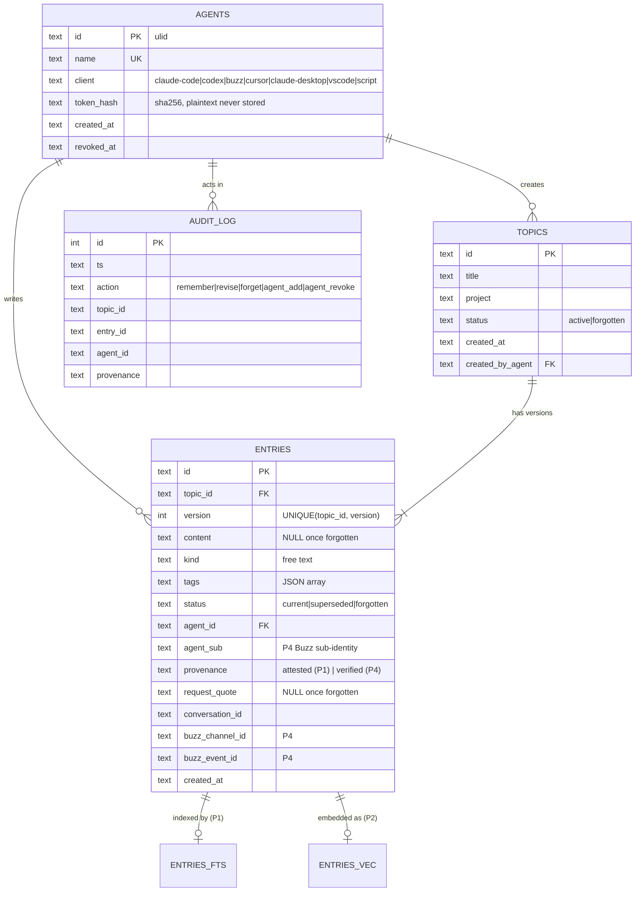
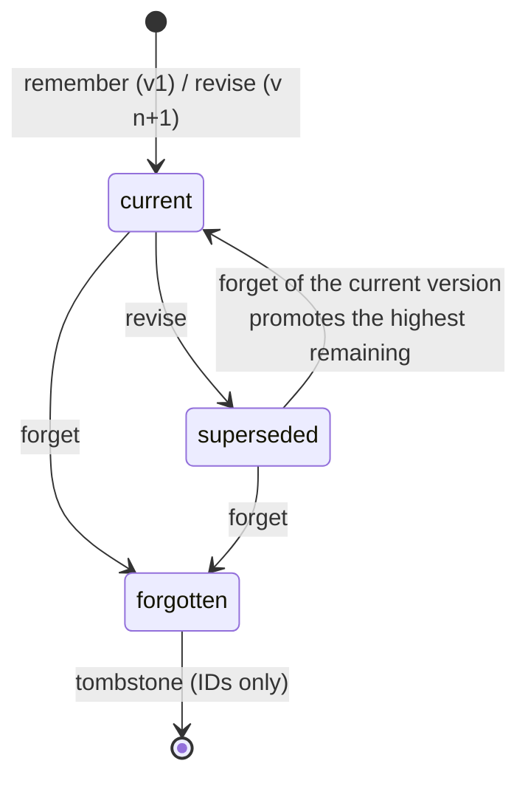

# Data model

**SQLite is the single source of truth.** All indexes and caches can be rebuilt from it, except forgotten content, which is gone by design.

## Entity relationships

There are also virtual and auxiliary tables:
- `entries_fts`: FTS5 over `(content, tags, title)`, with `entry_id UNINDEXED`. Added in P1.
- `entries_vec`: sqlite-vec `vec0(entry_id, embedding float[D])`. `D` comes from the configured model. Added in P2.
- `embedding_cache`: `hash(model ‖ text) → vector`. No plaintext is stored. Added in P3.
- `meta`: `schema_version`, `write_generation` and `embed_model`.

## Invariants (enforced by the database, not by convention)

| # | Invariant | Enforcement |
|---|---|---|
| I1 | At most one `current` entry per topic | `CREATE UNIQUE INDEX one_current_per_topic ON entries(topic_id) WHERE status='current'` |
| I2 | Versions are unique and increase | `UNIQUE(topic_id, version)`, and the service computes `max+1` inside the writer transaction |
| I3 | Forgotten means no text | `CHECK (status <> 'forgotten' OR (content IS NULL AND request_quote IS NULL))` |
| I4 | Non-forgotten entries have text and provenance | `CHECK (status = 'forgotten' OR content IS NOT NULL)`, `CHECK (provenance IN ('attested','verified'))` |
| I5 | Status values are closed sets | `CHECK (status IN ('current','superseded','forgotten'))` on entries, and `('active','forgotten')` on topics |
| I6 | Audit never holds content | No content columns exist in `audit_log` |
| I7 | Index consistency | A forgotten entry has no FTS, vec or C2 row. This is asserted by tests and by `agent-memory doctor --deep` |

## Entry lifecycle

## Time queries (`as_of`)
"What was true at time T" is the latest **non-forgotten** version per topic with `created_at <= T`. A forgotten version is never returned, even when it was current at T, because forgetting is retroactive by design.

## Migrations by phase

| File | Phase | Adds |
|---|---|---|
| `0001_init.sql` | P1 | agents, topics, entries (+ I1–I5), entries_fts, audit_log, meta |
| `0002_vectors.sql` | P2 | entries_vec, `meta.embed_model`, backfill queue table `embed_jobs` |
| `0003_cache.sql` | P3 | embedding_cache, recall statistics columns used by the brief |
| `0004_buzz.sql` | P4 | provenance `verified` path, agent_sub/buzz columns become used (they already exist from 0001) |

**Rules:**
- Migrations are forward-only and numbered.
- Never edit a migration once it has been applied.
- The runner records `schema_version` in `meta` and refuses to start against a newer schema than it knows.
- A changed embedding model needs `agent-memory reembed`, which rebuilds `entries_vec` from `content`.

## PRAGMAs
`journal_mode=WAL`, `synchronous=NORMAL`, `foreign_keys=ON`, `busy_timeout=5000`, `temp_store=MEMORY`. P3 adds `cache_size`/`mmap_size` tuning.
