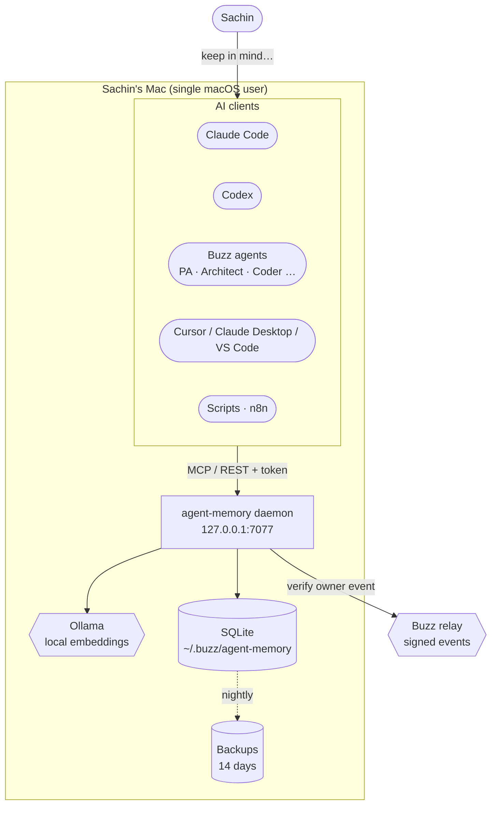
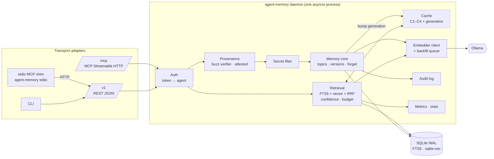
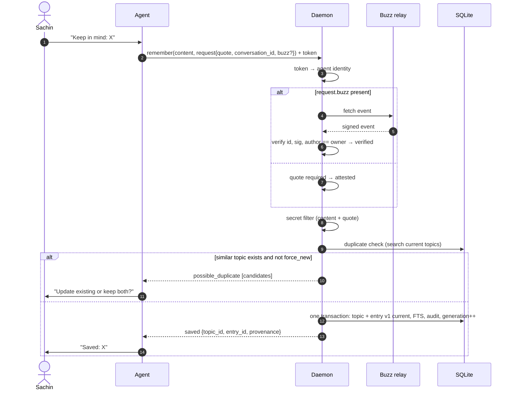
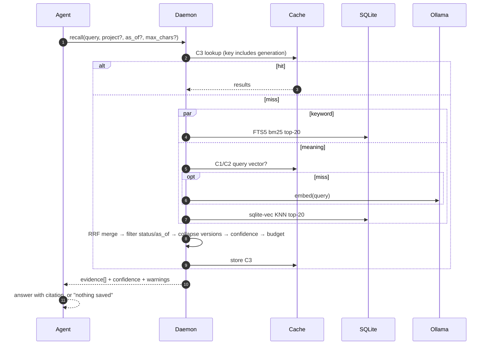
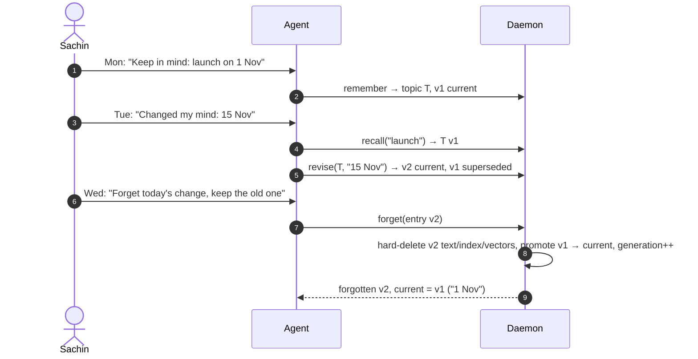
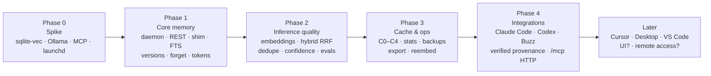

# Target architecture

This is the end-state design that all phases build towards. What each phase actually ships is in `phase-N/ARCHITECTURE.md`. This file changes only through an ADR.

## 1. System context

**Boundaries**
- Nothing listens beyond `127.0.0.1`. The only outbound call is to the Buzz relay, and only to verify a Buzz request. Text never leaves the Mac.
- The daemon is the only process that opens the database.

## 2. Containers and components

**Layering rule:** adapters → application services → core → storage. Adapters only translate, and all rules live in the core. MCP and REST are two views of one service API, so they can't drift apart (see ADR 0006).

## 3. Key flows

### 3.1 Remember (write)

### 3.2 Recall (read)

### 3.3 Change of mind, then forget (versions)

## 4. Quality attributes and how the design meets them

| Attribute | Mechanism |
|---|---|
| Correctness of "what is true now" | DB-enforced one-current-per-topic, transactional revise and forget |
| Owner-only writes | Provenance check in the daemon. Buzz-signed requests are verified. Requests from other tools are labelled `attested` (ADR 0003) |
| Real forgetting | Hard delete of content, quote, FTS, vector and C2 rows, plus a generation bump that invalidates C3 and C4 |
| Low latency | One process, a warm model, the cache layer, and SQLite read in-process (ADR 0005) |
| Any client | One service API exposed as MCP stdio, MCP HTTP and REST, with per-client config presets (ADR 0002, 0006) |
| Degrades safely | Ollama down → keyword-only recall with a warning, and writes still succeed with the embedding backfilled |
| Changeable | Ports for embedder, provenance verifier and transport. Numbered migrations. Phase snapshots and ADRs |

## 5. Phase map

| Component | P1 | P2 | P3 | P4 |
|---|---|---|---|---|
| Daemon + REST `/v1` | ✅ | | | |
| stdio MCP shim | ✅ | | | |
| MCP Streamable HTTP `/mcp` | | | | ✅ |
| Token registry and attribution | ✅ | | | Buzz sub-identity |
| Provenance | attested | | | + verified (Buzz) |
| Topics, versions, forget, audit | ✅ | | | |
| FTS5 recall + confidence | ✅ | | | |
| Embeddings + hybrid RRF + dedupe | | ✅ | | |
| Evals (`agent-memory eval`) | FTS cases | ✅ hybrid | | |
| Cache C0–C4, stats | | | ✅ | |
| Backups, export, reembed | | | ✅ | |
| Client presets and snippets | | | | ✅ |

## 6. Decisions
See [adr/README.md](adr/README.md).
