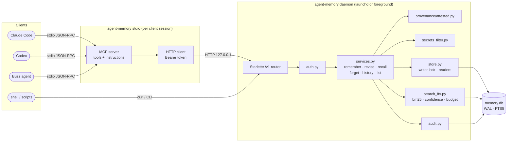
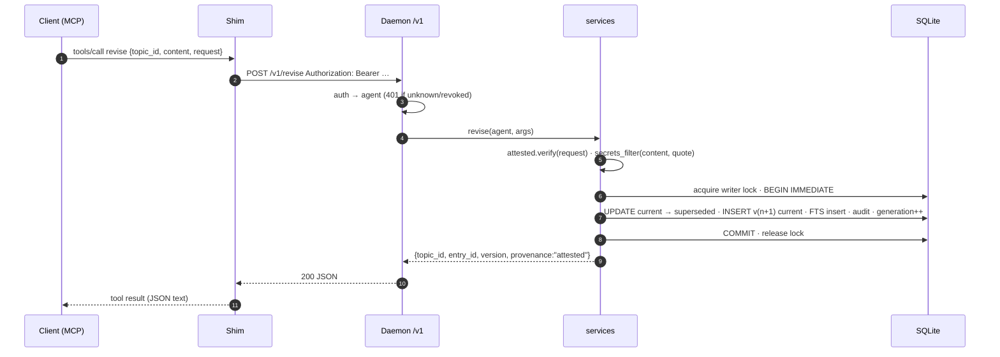
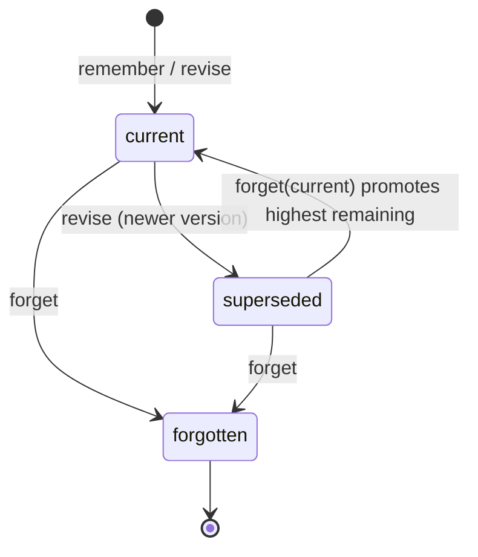
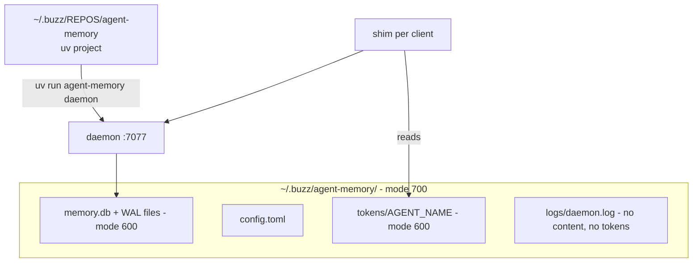

# Phase 1 architecture: core memory

**Goal:** make the correctness model solid before adding intelligence. Phase 1 ships a working local memory for any MCP client:
- remember, revise, recall, forget, history and list;
- keyword search only;
- versions, owner-request provenance (attested), real forgetting, agent attribution and an audit trail.

Deliverables and acceptance live in [OUTPUT.md](OUTPUT.md). The full target is in [../OVERVIEW.md](../OVERVIEW.md).

## 1. Scope

| In Phase 1 | Deferred (phase) |
|---|---|
| Daemon on `127.0.0.1:7077`, REST `/v1` | MCP Streamable HTTP `/mcp` (P4) |
| stdio MCP shim (the MCP surface for clients) | Client config presets and snippets (P4) |
| Token registry, `agent add/list/revoke` | Buzz sub-identity proof (P4) |
| Provenance **attested** (quote required) | **verified** Buzz event check (P4) |
| Topics, versions, revise, forget (all 4 modes), history, list | Duplicate detection on remember (P2) |
| FTS5 recall with rank, confidence, `max_chars` budget | Embeddings, hybrid RRF (P2) |
| Secret filter | Cache C0–C4 (P3) |
| Audit log, structured logs | Backups, export, reembed, stats (P3) |
| CLI: `daemon`, `stdio`, `agent …`, `recall`, `list`, `history`, `doctor` | `eval` with hybrid gates (P2; P1 has FTS fixtures) |

## 2. Runtime view



- **Why the shim is the only MCP surface in Phase 1:** Claude Code and Codex, the first clients, both launch stdio MCP servers. A shim that maps tool calls to REST keeps a single service API (ADR 0006), and adding `/mcp` HTTP in P4 is then a new adapter, not a rewrite.
- **Process model:** one daemon process with one asyncio loop.
  - All writes go through a single writer connection behind an `asyncio.Lock`. Reads use a small pool of read-only connections.
  - WAL mode lets readers keep reading while a write is in progress.
- **Startup:** if the shim can't reach the daemon, it starts `agent-memory daemon` in the background and retries for 3 s. launchd install is a Phase 3 command; Phase 1 accepts either a manual start or a shim-spawned one.

## 3. Module layout (Phase 1)

```
src/agent_memory/
  config.py          # paths, port, owner pubkey, limits (env + ~/.buzz/agent-memory/config.toml)
  daemon.py          # Starlette app, /v1 routes, error mapping, startup checks
  auth.py            # Bearer token → Agent (sha256 lookup, revoked check)
  services.py        # application services: one function per tool, transaction boundaries
  provenance/
    __init__.py      # Verifier port: verify(request) -> Provenance | error
    attested.py      # quote required, non-empty, ≤ 2,000 chars
  secrets_filter.py  # regex + Luhn + Verhoeff; scans content and quote
  store.py           # connections, PRAGMAs, migrations runner, writer lock
  search_fts.py      # FTS5 query building, bm25, confidence, as_of, collapse, budget
  audit.py           # append-only audit rows (no content)
  shim.py            # MCP stdio server (official SDK) → HTTP client
  cli.py             # Typer CLI
migrations/0001_init.sql
tests/ (unit, integration via TestClient, shim parity, fixtures/)
```
**Seams kept open for later phases:**
- `provenance.Verifier`: P4 adds `buzz.py`.
- `search_*`: P2 adds `search_vec.py` and `rank.py` (RRF).
- `services` calls `cache.invalidate()`, which is a no-op in Phase 1 and becomes real in P3.
- `embed.py` is absent in Phase 1.

## 4. Request lifecycle



All writes follow the same pattern: validate everything *before* taking the lock, then make a short `BEGIN IMMEDIATE` transaction. The unique partial index in the database rejects a second `current` row even if the code has a bug.

## 5. Interfaces (Phase 1)

### REST `/v1` (POST, JSON, `Authorization: Bearer <token>`)
| Endpoint | Body | Returns |
|---|---|---|
| `/v1/remember` | `content, title?, kind?, tags?, project?, request{quote, conversation_id?}` | `{topic_id, entry_id, version:1, provenance}` |
| `/v1/revise` | `topic_id, content, kind?, tags?, request` | `{topic_id, entry_id, version, superseded_entry_id}` |
| `/v1/recall` | `query, project?, as_of?, include_history=false, limit=8, max_chars=4000` | `{results[], confidence, warnings[]}` |
| `/v1/forget` | one of `entry_id` \| `topic_id` \| `conversation_id` \| `{since, agent?}`, plus `request` | `{forgotten[], now_current[]}` |
| `/v1/history` | `topic_id` | `{versions[]}` (forgotten versions appear as tombstones) |
| `/v1/list` | `project?, since?, agent?, limit=50` | `{topics[]}` |
| `GET /v1/health` | none | `{ok, schema_version, fts5:true}` (no auth) |

Each recall result carries `topic_id, entry_id, title, version, content, kind, tags, agent, provenance, request_quote?, created_at, conversation_id, status, rank, truncated`. The response also carries `confidence` (`high|medium|low|none`) and `warnings` (for example `keyword_only` is always present in Phase 1, so agents know paraphrases may be missed).

### MCP (via the shim)
- **Tools:** the same six, with identical argument names.
- **Server `instructions`** carry the usage contract: write only on an explicit request with the quote; recall before answering; revise instead of duplicating; cite or say nothing is saved.

Exact wording and error copy are owned by [../../40-interfaces/AGENT_UX.md](../../40-interfaces/AGENT_UX.md).

### Errors
The shape is `{error, message}`, with these codes:

| HTTP | Codes |
|---|---|
| 400 | `missing_quote`, `invalid_args`, `looks_like_secret` |
| 401 | `unauthorized` |
| 404 | `not_found` |
| 409 | `conflict` (a concurrent revise lost the race, so retry) |
| 500 | `internal` (never includes content) |

## 6. Data (Phase 1 subset)
[../DATA_MODEL.md](../DATA_MODEL.md) has the full model. Migration `0001_init.sql` creates `agents`, `topics`, `entries`, `entries_fts`, `audit_log` and `meta`. Phase 1 has **no** `entries_vec` and **no** `embedding_cache`: P2 adds them in `0002`, and P3 adds the cache tables in `0003`.

## 7. Retrieval in Phase 1 (FTS only)
1. Normalise the query: lowercase, strip punctuation, drop stop-words, and quote tokens for FTS5 safety. Add a prefix match on the last token.
2. Run `entries_fts MATCH` joined to `entries` and `topics`. Filters: `status='current'` (or every non-forgotten version if `include_history`), `project`, and `as_of` (latest non-forgotten version per topic with `created_at <= as_of`).
3. Rank by `bm25(entries_fts, 1.0, 0.5, 2.0)`, weighting content, tags and title. Show each topic once unless `include_history` is set.
4. **Confidence (FTS heuristic):** term coverage of the top hit (the share of query terms matched) combined with the bm25 gap to the second hit. `none` means no hits. Thresholds come from the Phase 1 fixtures and are documented in [../../20-inference/RETRIEVAL.md](../../20-inference/RETRIEVAL.md).
5. **Budget:** fill results up to `max_chars`, truncate the last one with `truncated=true`, and never drop IDs or provenance.

## 8. Forget semantics (Phase 1)


A `forget` runs as one transaction:
1. For each target entry: set `content = NULL` and `request_quote = NULL`, delete its `entries_fts` row, and set `status = 'forgotten'`.
2. If a target was `current`, promote the highest remaining `superseded` version. If none remain, set the topic to `forgotten`.
3. Write an audit row (IDs only) and bump `write_generation`.

"Forgotten" means gone from active memory. Backups (P3) keep old copies until they rotate out. [THREAT_MODEL](../../30-security/THREAT_MODEL.md) owns that wording.

## 9. Deployment (Phase 1)


- Python 3.13 with a `uv`-managed venv. Phase 0 confirms the Python/SQLite build (FTS5 is required now; extension loading is required in P2).
- Registering Claude Code and Codex is manual in Phase 1 (one documented command each). Presets arrive in P4.

## 10. Observability (Phase 1)
- Structured JSON logs record: request id, endpoint, agent id, latency in ms, result count, confidence, error code. They **never** record content, quotes, queries or tokens. A unit test asserts this.
- `GET /v1/health` and `agent-memory doctor` check that the daemon is reachable, the schema version, FTS5, file modes and the owner config.

## 11. Known changes planned for Phase 2+ (so readers aren't surprised)
- P2: `recall` becomes hybrid (FTS + vector, merged by RRF). `remember` gains `possible_duplicate`. The `keyword_only` warning disappears when Ollama is up.
- P3: generation bumps start invalidating real caches. Backups add a retention caveat to forget.
- P4: `/mcp` HTTP, `verified` provenance and Buzz sub-identity. Client presets write configs (with `--dry-run`).

When those land, `phase-2/ARCHITECTURE.md` opens with **"Changes since phase 1"**, and this file is frozen.
