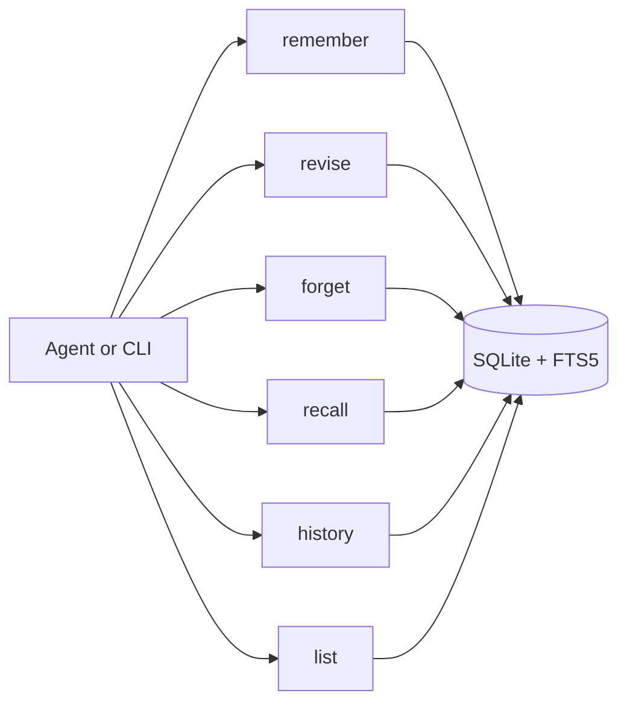

# Phase 1 output

Phase 1 delivers the smallest reliable memory product: a local daemon, a durable SQLite store, explicit writes, versioned memories, keyword recall and hard active forget. It deliberately excludes embeddings, hybrid ranking and cache layers beyond SQLite itself.

## Objective
Prove the correctness model before optimisation.

Phase 1 must answer:
- Can any registered local agent save and recall memory through one shared service?
- Can the system track which agent wrote a memory?
- Can changed decisions become new versions without losing history?
- Can forgetting remove active content from every Phase 1 retrieval path?
- Can agents use the same behaviour through REST and stdio?

## Deliverables
| Area | Deliverable |
|---|---|
| Runtime | Local daemon bound to `127.0.0.1` |
| Interfaces | REST endpoints and stdio shim for MCP-style clients |
| Storage | SQLite database under `~/.buzz/agent-memory/` |
| Search | FTS5 keyword recall with rank and confidence metadata |
| Identity | Agent registry with hashed bearer tokens |
| Memory lifecycle | `remember`, `revise`, `recall`, `forget`, `history`, `list` |
| Provenance | Phase 1 attested writes with request quote; verified Buzz provenance deferred to Phase 4 |
| Safety | Secret filter, metadata-only audit log, local file permissions |
| Operations | Basic `doctor` command and developer-run daemon |
| Tests | pytest coverage for invariants and transport parity |

## Phase 1 tool set

## Included CLI commands
- `agent-memory daemon`
- `agent-memory stdio --token-file <path>`
- `agent-memory agent add`
- `agent-memory agent list`
- `agent-memory agent revoke`
- `agent-memory recall "<query>"`
- `agent-memory list`
- `agent-memory history <topic_id>`
- `agent-memory doctor`

## Request and response expectations
### `remember`
Stores one memory entry as version 1 of a topic.

Required:
- authenticated agent token
- `content`
- `request.quote`

Returns:
- `topic_id`
- `entry_id`
- `version=1`
- `status=current`
- `agent`
- `provenance=attested`

### `revise`
Creates a new current version for an existing topic.

Required:
- authenticated agent token
- `topic_id`
- new `content`
- `request.quote`

Returns:
- new `entry_id`
- incremented version
- previous version marked `superseded`

### `recall`
Returns ranked evidence, not final prose.

Required:
- authenticated agent token
- `query`

Returns:
- current entries only by default
- `rank`
- `confidence`
- source metadata
- agent attribution
- optional `warnings`

### `forget`
Removes active memory content for exactly one target selector:
- `entry_id`
- `topic_id`
- `conversation_id`
- `since` plus optional `agent`

Returns:
- forgotten IDs
- the newly current version when one is promoted
- tombstone metadata

## Acceptance criteria
### Functional
- A valid registered token can call all Phase 1 tools.
- A revoked token receives `401` and cannot read or write.
- Agent attribution comes from the token, never a request argument.
- Remember creates exactly one current version.
- Revise creates a new current version and supersedes the old one.
- Recall returns current entries only unless `include_history=true`.
- `as_of` returns the latest non-forgotten version at or before the requested time.
- Forgetting the current version promotes the latest remaining superseded version.
- Forgetting a topic removes all active versions from recall.
- Forgetting by conversation affects only that conversation.

### Safety
- Secret-like content is rejected before storage.
- Forgotten entries have `content = NULL` and `request_quote = NULL`.
- Forgotten content is absent from FTS.
- Audit logs contain no memory content and no request quote.
- The daemon binds only to `127.0.0.1`.
- Database directory and token files have restrictive permissions.

### Inference
- Recall includes confidence: `high`, `medium`, `low` or `none`.
- Unrelated queries return `confidence=none` and no evidence.
- Low-confidence matches return a warning so the agent does not overstate.
- Long results respect `max_chars` and set `truncated=true`.

### Test and review
- Unit tests cover lifecycle, auth, recall, forget, secret filtering and transport parity.
- The Phase 1 test suite runs without a real Ollama server.
- PR evidence includes command output for the full test suite.

## Explicitly out of scope
- Ollama integration.
- `sqlite-vec`.
- Embedding cache.
- Hybrid ranking.
- Duplicate detection using vector similarity.
- C0-C4 caches.
- Buzz signature verification.
- launchd production install.
- backup rotation.
- Cursor, Claude Desktop and VS Code presets.
- UI.

## Exit evidence
Before Phase 1 is accepted, the PR must include:
- schema/migration summary
- tool/API summary
- test commands and results
- confirmation that forgotten content is absent from FTS
- known limitations and Phase 2 handoff notes
