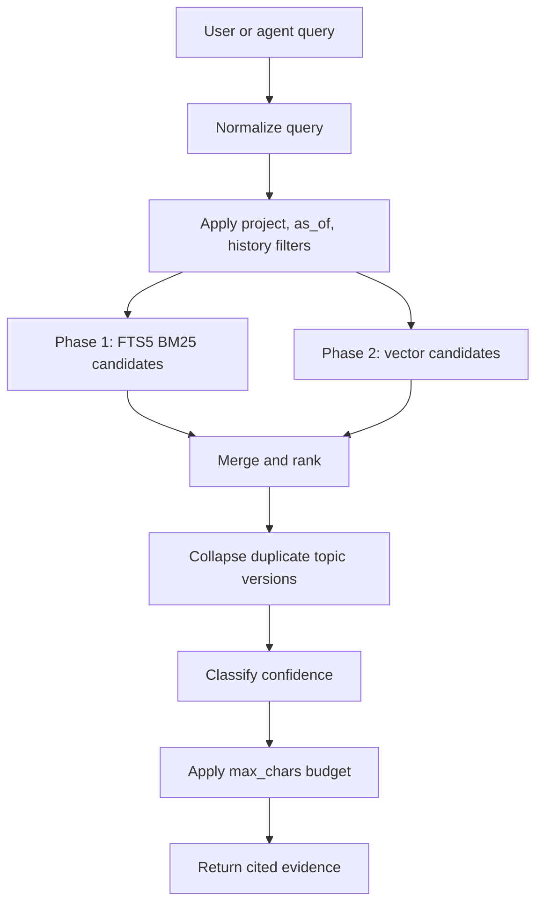

# Retrieval and inference contract

`agent-memory` is an inference support system, not just a database. The service returns bounded, ranked evidence with confidence and provenance so agents can answer from memory without inventing missing facts.

## Core contract
- `recall` returns evidence, not final prose.
- Agents cite memory evidence by agent and date.
- Agents say "nothing saved" when recall returns no evidence.
- Agents treat low-confidence results as uncertain.
- Fresh recall is authoritative over summaries and cached briefs.
- The service must never return forgotten content through active recall.

## Retrieval pipeline

## Phase 1 retrieval
Phase 1 uses only FTS5.

Candidate behaviour:
- Search `content`, `title` and `tags`.
- Return current entries only by default.
- Include superseded entries only when `include_history=true`.
- Use `as_of` to select the latest non-forgotten version created at or before the requested time.
- Never return entries with `status=forgotten`.

Required result fields:
- `topic_id`
- `entry_id`
- `title`
- `version`
- `content`
- `kind`
- `tags`
- `agent`
- `agent_sub`
- `provenance`
- `created_at`
- `conversation_id`
- `status`
- `rank`
- `confidence`
- `truncated`
- `warnings`

## Phase 2 retrieval
Phase 2 adds semantic search.

Candidate behaviour:
- Run FTS5 top-k and vector top-k independently.
- Merge candidates with reciprocal rank fusion.
- Collapse duplicate entries from the same topic unless `include_history=true`.
- Record score/debug fields in development and tests.

Default candidate parameters:
- FTS candidate count: 20
- vector candidate count: 20
- final limit: 8
- RRF constant: 60

These defaults can change through an ADR once eval data exists.

## Confidence policy
Recall confidence is a server-level signal that agents use to avoid overclaiming.

| Confidence | Meaning | Agent behaviour |
|---|---|---|
| `none` | No useful evidence | Say nothing is saved |
| `low` | Weak or ambiguous candidates | Ask for confirmation or phrase as uncertain |
| `medium` | Reasonable match, may need context | Answer with citation and avoid broad claims |
| `high` | Strong direct evidence | Answer with citation |

Phase 1 confidence can use deterministic FTS thresholds. Phase 2 should incorporate vector distance and hybrid rank, but must stay deterministic for tests.

## Warnings
`recall` can return warnings:
- `low_confidence`
- `keyword_only`
- `embedder_unavailable`
- `cache_disabled`
- `truncated`
- `as_of_no_current_match`

Warnings are part of the contract. Agents should surface them only when they affect the answer.

## Context budgeting
Agents have limited tool-result and prompt budgets. `recall` therefore accepts:
- `limit`
- `max_chars`
- `include_history`
- `project`
- `as_of`

Rules:
- Preserve IDs, metadata, rank and provenance even when content is truncated.
- Mark truncated content with `truncated=true`.
- Do not silently drop provenance to save space.
- Prefer fewer complete high-confidence memories over many partial low-confidence memories.

## Memory brief
The memory brief is introduced after core recall is stable.

Rules:
- It is explicit and scoped: `brief(project?, max_chars=2000)`.
- It is not automatically injected as global context for every agent.
- It includes `generated_at`, `write_generation`, `project` and included topic IDs.
- It is a summary, not evidence. Agents must call `recall` before making a specific factual claim.

## Write-time normalization
The original saved content remains the source of truth. The server may derive:
- normalized title
- normalized tags
- language hint
- optional local summary for long content

Constraints:
- deterministic
- local only
- no cloud model
- no replacement of original content

## Evaluation suite
Retrieval quality must be measurable before optimisation.

Fixtures:
- `tests/fixtures/memories.jsonl`
- `tests/fixtures/queries.jsonl`

Eval command:
- `agent-memory eval`

Metrics:
- recall@k
- mean reciprocal rank
- false positives
- stale/superseded leakage
- forgotten-content leakage
- degraded-mode behaviour

## Eval gates by phase
| Phase | Required gate |
|---|---|
| Phase 1 | Exact and keyword-paraphrase queries pass; semantic paraphrases can be expected failures |
| Phase 2 | Hybrid retrieval improves paraphrases without increasing false positives |
| Phase 3 | Cache-on and cache-off eval results are identical |
| Phase 4 | Cross-client recall behaviour remains equivalent |

## Failure modes
| Failure | Required behaviour |
|---|---|
| No match | Return no evidence with `confidence=none` |
| Weak match | Return candidates with `confidence=low` and warning |
| Ollama unavailable | Phase 2+ falls back to keyword-only recall |
| Cache disabled | Results remain identical, only slower |
| Forgotten target | Never return content in active recall or brief |
| Oversized result | Truncate content with metadata intact |
