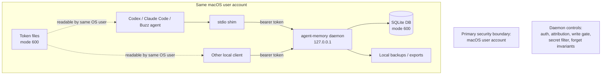

# Threat model

agent-memory stores personal long-term memory for Sachin's local AI agents. The service must protect memory content, write intent, provenance, deletion semantics and agent attribution without pretending that local per-agent tokens are stronger than the macOS user boundary.

## Security posture

The system is a single-user local daemon. Its real protection boundary is the local macOS account plus the daemon API. Agent bearer tokens provide authentication, attribution and revocation at the daemon, but they are not hard isolation between local clients running as the same OS user.

## Assets

| Asset | Why it matters |
|---|---|
| Memory content | May contain private preferences, decisions, project details or personal facts |
| Request quotes | Can reveal sensitive user instructions and must be deleted with forgotten entries |
| Agent bearer tokens | Grant daemon access for local clients |
| Agent attribution | Determines which client wrote or changed a memory |
| Buzz owner provenance | Distinguishes cryptographically verified owner requests from local attestation |
| SQLite DB, FTS, vector rows and caches | Every storage layer can leak stale or forgotten data if not cleared |
| Backups and exports | May retain old content outside active memory |
| Audit log | Useful for accountability, but unsafe if it stores content or secrets |
| Client config files | Can expose token paths, tokens or unsafe daemon endpoints |

## Trust model

| Mechanism | Trust level | Security meaning |
|---|---|---|
| macOS user account | Strongest local boundary | Protects files and local daemon access from other OS users when permissions are correct |
| Daemon bearer auth | Enforced service boundary | Allows registered clients and blocks missing, invalid or revoked tokens |
| Agent registry | Attribution control | Records which token/client performed an action |
| Caller-supplied agent fields | Untrusted | Must be ignored or rejected for identity decisions |
| Buzz verified request | Owner-proof provenance | Event id, signature and owner pubkey prove Sachin authored the request |
| Attested request | Audit label only | Local client claims Sachin asked; useful for UX, not cryptographic proof |
| Secret filter | Best-effort prevention | Reduces accidental credential/identity storage; cannot prove all secrets are absent |
| Forget operation | Active-memory deletion | Removes from active DB/index/cache layers; backups may retain content until rotation |

## In-scope threats

### Unauthorized local API access

- Severity: HIGH
- Vulnerability: daemon exposed beyond localhost or endpoints missing bearer auth.
- Attack scenario: another device or local unregistered process calls `recall` or `export` and reads saved memory.
- Affected area: daemon bind address, REST endpoints, MCP HTTP endpoint.
- Evidence: design requires `127.0.0.1` binding and bearer auth for `/v1/*` and MCP calls.
- Recommended mitigation: bind only to `127.0.0.1`; require auth on every sensitive route; keep health checks non-sensitive.
- Verification method: integration test asserts socket host; API tests for missing, invalid, valid and revoked tokens on every endpoint.

### Agent identity spoofing

- Severity: HIGH
- Vulnerability: accepting `agent_id`, `agent_name` or `agent_sub` from request JSON as authoritative.
- Attack scenario: a client writes or deletes memory while claiming to be PA or another trusted agent.
- Affected area: identity middleware, `remember`, `revise`, `forget`, audit rows.
- Evidence: repo rule says agent identity comes from bearer token and Buzz sub-identity proof, never tool arguments.
- Recommended mitigation: derive `agent_id` from token lookup only; treat caller-provided identity fields as invalid; verify Buzz sub-identity separately.
- Verification method: tests send forged identity fields and assert stored attribution still matches the token or request is rejected.

### Memory written without owner intent

- Severity: HIGH
- Vulnerability: normal conversation text is saved without explicit "keep in mind" style instruction.
- Attack scenario: an agent stores sensitive or low-quality chat content as durable memory.
- Affected area: MCP instructions, write request schema, provenance validation.
- Evidence: design requires a `request` object with exact quote for every write.
- Recommended mitigation: require non-empty `request.quote`; for Buzz writes, verify event id/signature/owner pubkey; label non-Buzz writes as `attested`, not verified.
- Verification method: tests for missing quote, empty quote, non-owner Buzz event, tampered Buzz event and valid owner Buzz event.

### Sensitive data stored accidentally

- Severity: HIGH
- Vulnerability: tokens, passwords, OTPs, card numbers or Aadhaar numbers are accepted into content or request quotes.
- Attack scenario: Sachin asks an agent to remember a key or password; later any registered local agent can recall it.
- Affected area: secret filter, write path, tests, logs.
- Evidence: design calls for rejecting API keys, tokens, passwords, OTPs, card numbers and Aadhaar numbers.
- Recommended mitigation: run secret filter before storage on both `content` and `request.quote`; return `looks_like_secret`; never log raw matches.
- Verification method: tests with representative synthetic patterns, including Luhn and Verhoeff checksum cases, and log assertions that rejected values are absent.

### Forgotten content remains active

- Severity: CRITICAL
- Vulnerability: forget clears the main entry but leaves content in FTS, vectors, embedding cache, recall cache or memory brief.
- Attack scenario: Sachin asks to forget a memory, but a later recall or brief returns the forgotten text from an index or cache.
- Affected area: `forget`, FTS, `entries_vec`, `embedding_cache`, C3 result cache, C4 brief.
- Evidence: design requires hard delete from active indexes and generation-based cache invalidation.
- Recommended mitigation: implement forget as one transactional operation per storage layer; delete index/cache rows before returning; bump generation inside the commit path.
- Verification method: direct SQL tests across active entries, FTS and, in later phases, vector/cache tables; cache-on/cache-off recall tests after forget.

### Memory content leaks through audit, logs or errors

- Severity: HIGH
- Vulnerability: debug logs, audit rows or error responses include memory content, request quotes, bearer tokens or secret-filter matches.
- Attack scenario: local logs or test snapshots become a second copy of private memory or credentials.
- Affected area: audit logging, exception handling, CLI output, tests.
- Evidence: repo rule says never store or log memory content in `audit_log`, errors or debug logs.
- Recommended mitigation: audit only metadata IDs/actions; centralize safe error formatting; redact tokens; prohibit content in log contexts.
- Verification method: unit tests and snapshot review for log/error output; grep test artifacts for synthetic token/content markers.

### Backup and export retention surprise

- Severity: MEDIUM
- Vulnerability: product language implies immediate total erasure while backups keep forgotten content until rotation.
- Attack scenario: Sachin forgets a memory and later discovers it is still present in a local backup or export.
- Affected area: backup command, export command, docs, release notes.
- Evidence: design currently defines active-memory forget and notes backups keep old content until rotation unless backup purge is implemented.
- Recommended mitigation: use precise wording: "forgotten from active memory"; document backup retention; exclude tokens from backups/exports; consider explicit backup purge in a later ADR.
- Verification method: backup/export tests for token exclusion; documentation review before release.

### Unsafe client config writes

- Severity: MEDIUM
- Vulnerability: `agent add` rewrites client config incorrectly, stores plaintext tokens inline, or points clients at a non-local endpoint.
- Attack scenario: a client leaks tokens in config sync or connects to an attacker-controlled daemon endpoint.
- Affected area: client presets for Codex, Claude Code, Cursor, Claude Desktop, VS Code.
- Evidence: design requires dry-run/preview for config writes and token files under local memory directory.
- Recommended mitigation: write token file paths instead of inline tokens where client supports it; default to dry-run/preview; validate endpoint host is localhost.
- Verification method: fixture tests for generated config, file mode checks and no inline token in output after creation.

## Phase-specific controls

### Phase 1

- Bind daemon to `127.0.0.1`.
- Require bearer auth on REST and stdio-forwarded calls.
- Store token hashes only.
- Derive agent identity from token.
- Require request quote for writes.
- Implement secret filter before storage.
- Keep audit log metadata-only.
- Delete forgotten content and request quotes from `entries`.
- Delete forgotten content from FTS.
- Use direct SQL tests for forget invariants.

### Phase 2

- Delete vector rows for forgotten entries.
- Ensure embeddings are generated locally only.
- Do not send memory content to cloud models for normalization or ranking.
- Add eval cases proving forgotten and superseded content are absent from active recall.

### Phase 3

- Invalidate recall result cache and memory brief on every write.
- Delete content embedding-cache rows on forget.
- Keep query cache keys hashed; do not store query text in plaintext cache keys.
- Document backup retention and token exclusion.

### Phase 4

- Verify Buzz sub-identity proof for shared Buzz agent token use.
- Smoke test PA, Codex and Claude Code with write, recall, revise and forget.
- Verify install/launchd file modes and daemon bind address after installation.

## Required security test matrix

| Control | Required verification |
|---|---|
| Local-only daemon | Startup/integration test confirms `127.0.0.1` bind |
| Bearer auth | Missing, malformed, unknown, valid and revoked token tests |
| Token secrecy | Hash in DB; plaintext shown only at creation; no token in logs/snapshots |
| Attribution | Forged caller identity cannot change stored agent attribution |
| Write gate | Missing/empty quote rejected; attested and verified provenance labelled correctly |
| Buzz verification | Non-owner and tampered events rejected; owner event accepted |
| Secret filter | Synthetic API key, password, OTP, card and Aadhaar patterns rejected |
| Audit safety | Audit log contains action and IDs only |
| Forget active deletion | Direct SQL checks for `entries` and FTS in Phase 1 |
| Later forget layers | Direct SQL/cache checks for vectors, embedding cache, recall cache and brief as added |
| Error safety | Errors contain codes and safe summaries only |
| Config safety | Generated client configs do not inline tokens unless unavoidable and never target remote hosts |

## Open security decisions

1. Whether backups should support explicit purge of forgotten entries before the 14-day rotation window.
2. Whether exports should support redacted and full modes.
3. Whether token files should be encrypted with macOS Keychain in a later phase.
4. Whether remote/cloud-agent access is ever needed. If yes, it requires a separate design for OAuth, tunnel auth, CSRF, rate limiting and audit.

Any decision above that changes behavior, data retention or a trust boundary must be captured in an ADR before implementation.

## Closed security decisions

| Decision | Resolution | Evidence |
|---|---|---|
| Whether Phase 1 includes live Buzz verification | Closed: Phase 1 ships attested provenance only; verified Buzz provenance and Buzz sub-identity proof are deferred to Phase 4 | ADR 0003, ADR 0007, `ROADMAP.md`, and `10-architecture/phase-1/OUTPUT.md` |
