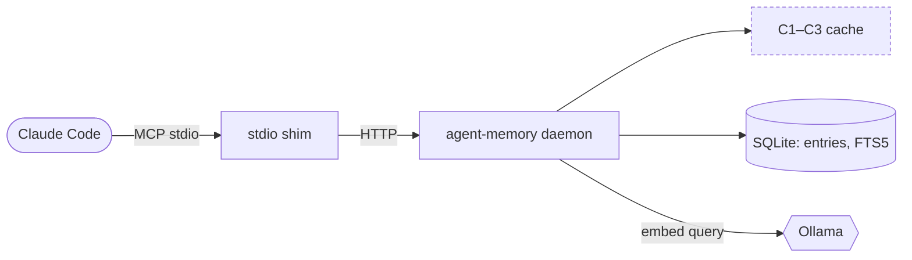

# Agent and CLI interface UX

This doc owns one question: **what does Sachin actually see or hear**, through an agent's words or a terminal, for every tool call? Argument shapes and ranking math live in [`10-architecture/phase-1/ARCHITECTURE.md`](../10-architecture/phase-1/ARCHITECTURE.md) and [`20-inference/RETRIEVAL.md`](../20-inference/RETRIEVAL.md). This doc is the contract for the words and the screen, not the wire format.

There is no UI (by requirement — see `docs/00-vision/END_GOAL.md`). That makes this surface *more* design-sensitive, not less: the only interface is conversation and a terminal, so every phrasing and every line of CLI output has to carry the full UX load that a screen would otherwise carry.

## 1. Two audiences, one contract

| Audience | Surface | What they need |
|---|---|---|
| Sachin, talking to an agent (PA, Claude Code, Codex, …) | The agent's natural-language reply | Trustworthy, short, correctly hedged answers that cite where a fact came from |
| Sachin, at a terminal | `agent-memory` CLI output | Scannable state for debugging and admin: what's saved, what's cached, what's broken |

Both read from the same tool results. Section 2 scripts the first surface. Section 4 designs the second. Both obey the same rule: **never surface raw internals (error codes, JSON, ranks, vectors) as the primary message — translate first, show detail only on request.**

## 2. The conversational contract

Every MCP tool's `instructions` (in [`10-architecture/OVERVIEW.md` §6.4](../10-architecture/OVERVIEW.md#64-mcp-server-instructions-canonical-text)) tell the agent *when* to call a tool. This section tells it *what to say* once the tool returns. Any agent built against agent-memory should follow this script.

### 2.1 `remember`

| Result | Say |
|---|---|
| Stored | One short line confirming what was kept, in Sachin's words where possible, not a restatement of the whole content: *"Saved — I'll remember that you prefer the Pro plan."* Don't echo the full text back if it's long; the content is the source of truth, the confirmation is just an ack. |
| `possible_duplicate` | Don't save silently and don't silently overwrite. Ask: *"You already have something saved about `<title>` (from `<date>`) — want me to update that instead of creating a new entry?"* Show at most 2 candidate titles. |
| `looks_like_secret` | *"That looks like it might contain a password, key, or card number, so I didn't save it. Want me to save it with that part removed?"* Never repeat the flagged text back. |
| `not_requested_by_owner` / `bad_signature` / `event_not_found` | One bucket, one message: *"I couldn't confirm that request was yours, so I didn't save anything."* Never mention signatures, pubkeys, or event IDs in the reply — that's `doctor`-level detail, not conversation. |

### 2.2 `recall` — confidence governs the sentence, not just the data

`recall` returns a `confidence` of `none | low | medium | high` (see `RETRIEVAL.md`). The agent's phrasing must change with it — this is the single highest-leverage UX rule in the whole system, because it's what keeps the agent from sounding either falsely certain or uselessly vague.

| Confidence | Agent behaviour | Template |
|---|---|---|
| `none` | Say nothing is saved. Never guess, never fall back to general knowledge and present it as recalled. | *"I don't have anything saved about that."* |
| `low` | Surface it, but hedge, and offer to confirm. Don't state it as fact. | *"I'm not fully sure, but I may have noted `<short excerpt>` on `<date>` — is that what you meant?"* |
| `medium` / `high` | Answer directly, but always cite agent + date. Confidence level itself is never spoken — it's expressed through hedging (low) or its absence (medium/high), not the word "confidence." | *"You told me on `<date>` that `<content>`."* / *"Based on what you said on `<date>`: `<content>`."* |

Rules that apply at every confidence level:
- Cite **agent + date**, every time, for medium/high. This is the only "provenance UI" Sachin gets, so it has to appear in-line, not as a footnote he has to ask for.
- If `truncated=true`, say so and offer more: *"…(there's more — want the full note?)"*, never silently cut text without a signal.
- If a result is `provenance: attested` vs `verified`, don't expose the word "attested" — that's an internal trust label (`THREAT_MODEL.md`), not something Sachin needs to parse mid-conversation.
- Degraded mode (`warnings: ["embedder_unavailable"]`, Phase 2+): the agent adds one clause, not an apology paragraph: *"(keyword search only right now — semantic matching is temporarily down)"*.

### 2.3 `revise`

*"Updated — that replaces what I had before."* If Sachin asks what changed, that's a `history` call, not something to dump unprompted.

### 2.4 `forget`

Forget always ends with **what is true now**, because "forgotten" alone leaves Sachin unsure what the system will say next time:
- Something became current again: *"Forgotten. You're back to what you told me on `<date>`: `<content>`."*
- Nothing remains: *"Forgotten — nothing's saved on that anymore."*

Forget is the one write worth a one-line confirm-back even when Sachin's phrasing was unambiguous ("forget the current one, keep the old"), because it's the only operation that destroys state. The confirmation is the undo-visibility, not a blocking prompt.

### 2.5 `brief`

Only ever loaded when an agent asks for it, never injected silently ([`20-inference/RETRIEVAL.md` §Memory brief](../20-inference/RETRIEVAL.md#memory-brief)). If used, the agent should treat it as background, not as an answer: a brief fact is not a substitute for calling `recall` when Sachin asks a direct question. Fresh `recall` always wins over brief content — if they conflict, trust `recall` and don't mention the discrepancy unless asked.

## 3. Error taxonomy → human translation

No error code, stack trace, or JSON body is ever the primary reply. This table is the full translation layer; an agent should never need to invent phrasing for a case not listed here — extend this table instead of ad-libbing in a prompt.

| Code / condition | Internal meaning | Say to Sachin |
|---|---|---|
| `not_requested_by_owner`, `bad_signature`, `event_not_found` | Buzz provenance check failed | *"I couldn't confirm that request was yours, so I didn't save anything."* |
| `looks_like_secret` | Secret filter tripped | *"That looks like it might contain a secret, so I didn't save it."* |
| `possible_duplicate` | Similar current topic exists | See 2.1 |
| `embedder_unavailable` (warning) | Ollama down | One trailing clause, see 2.2 — never a standalone apology message |
| `cache_disabled` (warning) | Dev/ops flag | Invisible to Sachin. Never surfaced in conversation; only relevant to `doctor`/`stats` |
| `low_confidence` (warning) | Weak match | Folded into the `low` phrasing in 2.2, not a separate message |
| 401 / revoked token | This agent's credential was revoked | CLI-only, never conversational: an agent with a dead token can't talk anyway. CLI says: `this agent's token was revoked — run: agent-memory agent rotate "<name>"` |

Rule of thumb: **if a code maps to an action Sachin can take, say the action in plain words. If it doesn't, say only what changed (saved / not saved / forgotten) and drop the code.**

## 4. CLI UX

The CLI is for Sachin at a terminal, debugging or administering — a different register from conversation: denser, scriptable, no hedging prose.

### 4.1 Principles
- **Every read command supports `--json`.** Human-readable table by default; `--json` for scripts or other agents shelling out. Never require parsing the human format.
- **No emoji, minimal color.** Status via ASCII marks (`✓`/`✗`/`·`) and words, not color alone — color-blind-safe and greppable in a redirected file.
- **Rank/debug fields are opt-in.** `score_debug` (FTS rank, vector distance, cache hit) only under `--debug`. Default output answers "what do I have," not "how was it ranked."
- **Destructive commands confirm by default.** `forget`, `agent revoke`, `agent rotate` print what will happen and require `--yes` to skip the prompt. No silent destructive action from a bare command.
- **Config-writing commands preview first.** `agent add <name> --client <preset>` writes to a real client config file (`~/.codex/config.toml`, `claude_desktop_config.json`, etc). Default run shows a diff-style preview of the exact lines it will add/change and asks to confirm; `--yes` skips the prompt, `--dry-run` previews and exits without writing. This was a gap Tech Lead flagged in review — the CLI must never overwrite an existing MCP server entry unannounced.
- **Secrets never echo twice.** A token prints once, at creation, with a one-line warning that it won't be shown again. Every later listing shows a fingerprint only (`sha256:ab12…`), never the token.

### 4.2 Example output shapes

`recall "pro plan"`:
```
[high]    Billing preference — v2 · Claude Code · 2026-09-14
          Sachin wants the Pro plan, billed yearly.

[low]     Plan comparison notes · PA (Buzz) · 2026-08-02
          …(truncated — agent-memory history <id> for full note)
```

`list`:
```
TOPIC                  CURRENT                                  AGENT          UPDATED
Billing preference     Pro plan, billed yearly                  Claude Code    2026-09-14
Travel dates           Mumbai, Nov 3–7                          PA (Buzz)      2026-09-30
```

`history <topic>`:
```
v3  current      2026-09-14  Claude Code     Pro plan, billed yearly
v2  superseded   2026-08-20  PA (Buzz)       Pro plan, billed monthly
v1  forgotten    2026-08-02  PA (Buzz)       — forgotten —
```

`forget <topic>` (no `--yes`):
```
This will forget "Billing preference" v3 (current).
v2 (2026-08-20, "Pro plan, billed monthly") will become current.
Continue? [y/N]
```

`doctor`:
```
✓ daemon reachable on 127.0.0.1:7077
✓ ollama: nomic-embed-text loaded (dim=768, warm)
✗ sqlite-vec: failed to load — falling back to FTS-only (see below)
✓ file modes: ~/.buzz/agent-memory 700, memory.db 600
```

`agent add "Cursor" --client cursor` (no `--yes`, no `--dry-run`):
```
Will write to ~/.cursor/mcp.json:
  + "agent-memory": { "url": "http://127.0.0.1:7077/mcp", "transport": "http" }
Token will be shown once after you confirm. Continue? [y/N]
```

### 4.3 Empty and first-use states
- `list` with nothing saved: `Nothing saved yet. Ask an agent to "remember" something, or run: agent-memory recall "<topic>" to check first.` — not a bare empty table.
- `recall` with no agents registered yet (fresh install): `No agents registered. Run: agent-memory agent add "<name>" --client <preset>` instead of an opaque auth error.

## 5. Diagram style guide

Every diagram across these docs is **Mermaid in the markdown** (README rule 6) — diffable, reviewed in the PR, rendered by GitHub. GitHub renders Mermaid in both light and dark theme, so hardcoded fill colors routinely go unreadable in one of the two. Convention: **carry meaning in shape and label, never in color alone.**

| Shape | Mermaid syntax | Use for |
|---|---|---|
| Stadium | `([Label])` | A human or external agent/client — anything outside the system that initiates a request |
| Rectangle | `[Label]` | A process or logic component we own (daemon, core modules) |
| Cylinder | `[(Label)]` | A durable store (SQLite, a table, a file) |
| Hexagon | `{{Label}}` | An external service we depend on but don't own (Ollama, the Buzz relay) |
| Dashed-border rectangle | `[Label]` + `classDef cache stroke-dasharray: 4 3` | A cache layer — dashed marks "fast, derived, disposable" at a glance |

Diagram-type conventions:
- **System/data flow → `flowchart LR`.** Left-to-right follows "client asks, system answers." Group same-boundary nodes in a `subgraph` (e.g. `subgraph Daemon`), not by color.
- **Request lifecycle / ordering → `sequenceDiagram`.** Anything where "who talks to whom, in what order" is the point (a provenance check, a forget cascading through cache layers).
- **Schema → `erDiagram`.** One diagram per schema version; it lives in `DATA_MODEL.md`, not duplicated here.
- **Decisions over time → plain Mermaid is the wrong tool.** Use the ADR log instead; don't try to diagram a decision history.

Minimal self-example (daemon request path):


Every diagram gets a one-line caption above it stating what it's showing and as-of which phase, since `phase-1/` diagrams will diverge from `phase-2/` ones and a reader landing mid-doc needs that without scrolling to the frontmatter.

## 6. Phase 1 scope note

Phase 1 ships FTS5 only — no embeddings, no vector recall (`ROADMAP.md`). Two consequences for this contract:
- `confidence` in Phase 1 is derived from BM25 rank alone. "Low confidence" means a weak keyword match, not "semantically related but lexically distant" — that case doesn't exist yet. Don't let agent phrasing imply semantic understanding Phase 1 doesn't have.
- `embedder_unavailable` cannot occur in Phase 1 (there's no embedder in the request path yet). The degraded-mode clause in §2.2 becomes live starting Phase 2, when recall begins depending on Ollama.

When Phase 2 lands hybrid ranking, this section gets a **"Phase 2"** subsection per the living-doc rule in `docs/README.md` — the Phase 1 behaviour above stays documented, not deleted.
