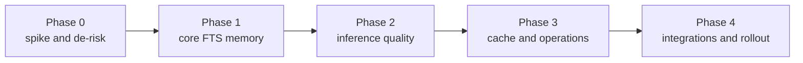
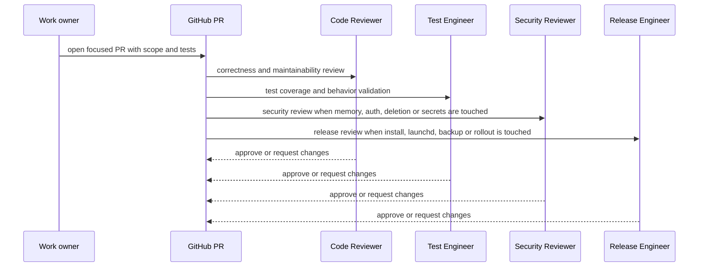

# Delivery workflow

This project uses the GitHub repo and PRs as the source of truth. Linear is intentionally not required.

All GitHub work must stay under **github-work / Pawardevelops**. Do not create tasks, projects, branches, PRs or issues under Onro, personal or any other GitHub account.

## Source of truth
- Architecture and product intent: `docs/`.
- Phase tracking: `docs/ROADMAP.md` and, when `Pawardevelops` GitHub Projects access is available, GitHub Projects/issues under `Pawardevelops/agent-memory`.
- Implementation evidence: PR descriptions, test output and reviewer comments.
- Release readiness: release checklist or install PR notes.

## Team routing
This project is a medium-to-large infrastructure feature with security and inference-quality risk. Use the minimum workflow per phase, not the full team for every small edit.

| Work type | Primary owner | Review path |
|---|---|---|
| End goal and delivery flow | Engineering Guide | Tech Lead |
| Architecture | Architect / Tech Lead | Code Reviewer, Security Reviewer where relevant |
| Inference design | Tech Lead | Test Engineer for eval coverage |
| Interface and CLI UX | Designer | Developer, Test Engineer |
| Security model | Security Reviewer | Tech Lead |
| Implementation | Developer | Code Reviewer, Test Engineer, Security Reviewer when sensitive |
| Local install and rollout | Release Engineer | Tech Lead, Security Reviewer |

## Phase sequence

## Phase gates

### Phase 0: spike and de-risk
Exit when the team has evidence for:
- Python can load the chosen SQLite extension path or a fallback is selected.
- Ollama model, dimension and latency are measured.
- MCP transport assumptions for Codex and Claude Code are confirmed.
- launchd feasibility is known.
- Client config paths are confirmed.

Deliverable: `docs/SPIKE_RESULTS.md`.

### Phase 1: core memory
Exit when:
- Daemon, REST API and stdio shim exist.
- SQLite schema and migrations exist.
- Token attribution works.
- FTS recall works with rank/confidence metadata.
- Remember, revise, recall, forget, history and list are tested.
- Forgotten active content is absent from content columns and FTS.

Required review: Code Reviewer and Test Engineer. Security Reviewer checks token handling, logging and forget behavior before merge.

### Phase 2: inference quality
Exit when:
- Embeddings and vector search work locally.
- Hybrid ranking improves deterministic eval results.
- Duplicate/conflict detection is implemented.
- Recall context budgeting and confidence are tested.

Required review: Tech Lead, Test Engineer and Code Reviewer.

### Phase 3: cache and operations
Exit when:
- Cache-on and cache-off recall results are identical.
- Writes invalidate result and brief caches.
- Forget removes active content from all relevant cache layers.
- Backup, export, reembed and stats commands work.

Required review: Code Reviewer, Test Engineer and Security Reviewer.

### Phase 4: integrations and rollout
Exit when:
- Codex, Claude Code and Buzz agent integrations work.
- Verified Buzz provenance works.
- A live smoke test saves, recalls, revises and forgets across clients.
- Release Engineer has install, rollback and backup notes.

Required review: Release Engineer, Security Reviewer and Tech Lead.

## PR flow

## PR checklist
Every PR should include:
- Phase and scope.
- Files changed.
- Acceptance checks satisfied.
- Tests run and results.
- Security notes or why security review is not required.
- Documentation changed or why no documentation change was needed.
- Rollback or operational notes if behavior affects local install.

## Branch and worktree rules
- Use branch `docs/project-docs` for this documentation pass.
- Use individual worktrees when several agents edit the repo.
- Edit only assigned files during coordinated documentation work.
- Rebase or update before pushing.
- Do not force-push shared coordination branches.
- Commit as `Pawardevelops <pawardevelops@gmail.com>` using the repo `AGENTS.md` instructions.

## GitHub Projects
Use GitHub Projects only if tool access is authenticated as **Pawardevelops / github-work**.

Until that access is available:
- Track phases in `docs/ROADMAP.md`.
- Use PRs for implementation evidence.
- Do not use connected GitHub accounts that belong to Onro, personal or unrelated workspaces.

## Done definition
A phase or PR is done when:
- Requirements for that scope are satisfied.
- Tests or documented verification exist.
- Security was considered for sensitive behavior.
- Documentation reflects the behavior.
- Known follow-up work is recorded.
- Release/install impact is known.

This definition scales with risk. A docs-only change does not need the same release process as daemon auth or forget semantics.
