# agent-memory: the end-to-end guide

**Shared, local, long-term memory for every AI agent on Sachin's Mac.**

This guide explains the whole system in one place:
- why it exists
- what it is made of
- how every request flows through it, step by step
- how data is stored, searched, cached, protected and forgotten
- how it is built and rolled out, phase by phase

It is the narrative companion to the reference docs. Where the two disagree, the reference doc wins: each section links to it. See the [docs index](README.md).

> **How to read the diagrams.** Shapes carry meaning (from [AGENT_UX §5](40-interfaces/AGENT_UX.md#5-diagram-style-guide)):
> - stadium `([ ])` = a person or an outside client
> - rectangle = a part we build
> - cylinder = stored data
> - hexagon `{{ }}` = an outside service we depend on
> - dashed border = a cache
>
> Each diagram has a caption saying which phase it shows.

---

## Contents
1. [The problem and the end goal](#1-the-problem-and-the-end-goal)
2. [Key ideas in plain words](#2-key-ideas-in-plain-words)
3. [The big picture](#3-the-big-picture)
4. [A week in the life: one story, end to end](#4-a-week-in-the-life-one-story-end-to-end)
5. [The parts, one by one](#5-the-parts-one-by-one)
6. [Every flow, step by step](#6-every-flow-step-by-step)
7. [How data is stored](#7-how-data-is-stored)
8. [How search works](#8-how-search-works)
9. [The cache layer](#9-the-cache-layer)
10. [Security and trust](#10-security-and-trust)
11. [How agents must behave](#11-how-agents-must-behave)
12. [Interfaces: MCP, REST, CLI](#12-interfaces-mcp-rest-cli)
13. [Where it runs: files, processes, lifecycle](#13-where-it-runs-files-processes-lifecycle)
14. [Operating it: health, metrics, troubleshooting](#14-operating-it-health-metrics-troubleshooting)
15. [Build phases and roadmap](#15-build-phases-and-roadmap)
16. [How the team delivers it](#16-how-the-team-delivers-it)
17. [Technology choices](#17-technology-choices)
18. [Decisions on record](#18-decisions-on-record)
19. [Limits, open questions, and the future](#19-limits-open-questions-and-the-future)
20. [FAQ](#20-faq)

---

## 1. The problem and the end goal

Today every agent forgets. What memory does exist is fragmented:

| Today | Why it fails |
|---|---|
| Always-loaded memory (e.g. Buzz `core`) | Small. It fits rules, not hundreds of facts |
| Cold memory (e.g. `buzz mem get <slug>`) | You only get a fact back by its exact name. With no search, a fact whose name is forgotten is lost |
| Chat history | Belongs to one tool, one session, one thread, so other agents can't see it |
| Each tool's own memory | Claude Code, Codex and Buzz agents each assume different things |

**End goal:** when Sachin says *"keep in mind…"* to **any** agent, that fact is saved once, locally. Later, **any** agent can find it, cite who saved it and when, update it when Sachin changes his mind, and truly forget it on request, with the previous version coming back.

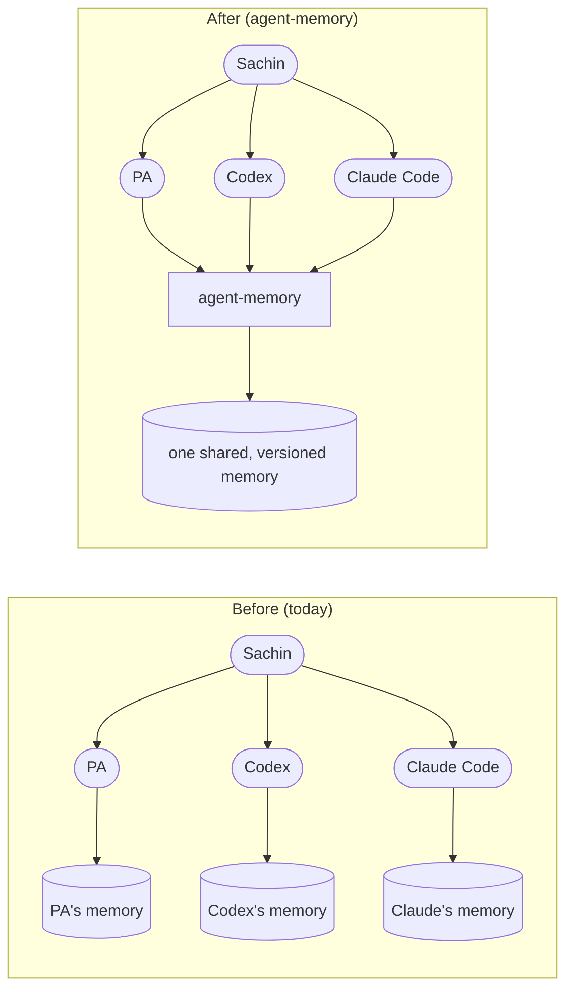
*Caption: why this exists (all phases).*

**Product principles** (from [END_GOAL](00-vision/END_GOAL.md)):
1. Capture only on an explicit request.
2. Evidence before an answer.
3. One current truth per topic.
4. Forget really removes the fact.
5. Local first.
6. Works with any agent.
7. Search returns evidence, not prose.
8. Delivered in small, reviewable phases.

---

## 2. Key ideas in plain words

| Term | Plain meaning | Example |
|---|---|---|
| **Memory / fact** | One small thing Sachin asked to keep | "Launch date is 1 Nov" |
| **Topic** | The subject a fact belongs to. It holds every version | "Launch date" |
| **Version (entry)** | One saved state of a topic: v1, v2, v3… | v1 "1 Nov", v2 "15 Nov" |
| **Current** | The version agents treat as true now. A topic has exactly one | v2 |
| **Superseded** | An older version, kept as history | v1 |
| **Forgotten** | A deleted version. Its text is gone and only an empty marker remains | v2 after "forget that" |
| **Agent** | Any AI client registered with the memory | PA, Codex, Claude Code |
| **Token** | The key an agent uses to talk to the memory. It identifies which agent is acting | `am_…` (shown once) |
| **Provenance** | How we know Sachin asked for a fact | `verified` or `attested` |
| **Verified** | The request was a Buzz message signed by Sachin, which we checked cryptographically | Phase 4 |
| **Attested** | The agent quoted Sachin's exact words, but they can't be checked cryptographically | Claude Code terminal |
| **Conversation ID** | Which chat a fact came from, so "forget this discussion" works | a Buzz thread or Codex session |
| **Recall** | Searching the memory. Returns evidence with a confidence level | "what's the launch date?" |
| **Confidence** | How strong the match is: `high`, `medium`, `low` or `none` | `none` means "nothing saved" |
| **Generation** | A counter that goes up on every write. Caches use it to know they're stale | 41 → 42 |
| **Daemon** | The always-on background program that owns the memory | `agent-memory daemon` |
| **Shim** | A tiny adapter that lets stdio-only tools talk to the daemon | `agent-memory stdio` |
| **Embedding** | Numbers that capture meaning, so "car" can match "vehicle" | from Ollama, Phase 2 |

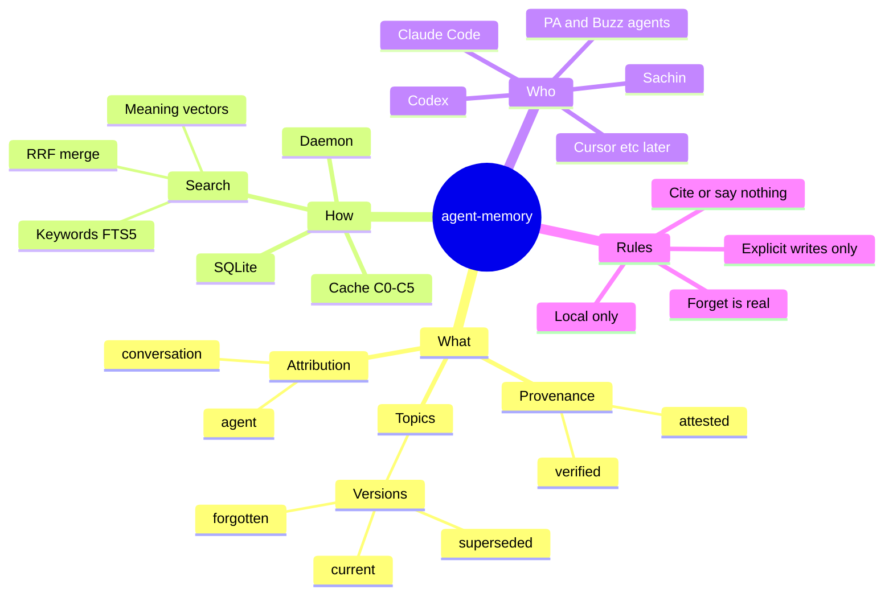
*Caption: concept map (all phases).*

---

## 3. The big picture

### 3.1 System context
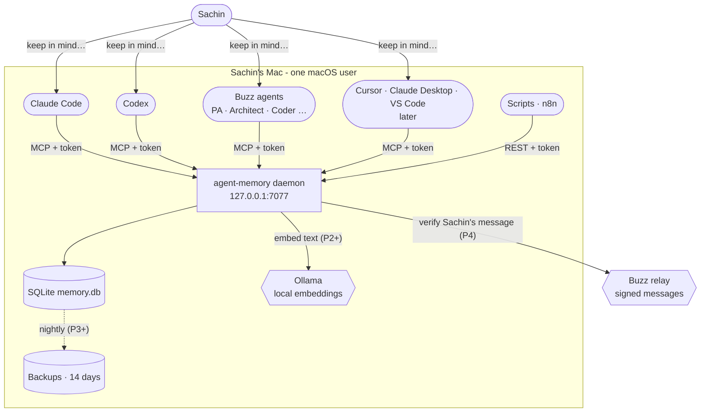
*Caption: target system context (all phases; labels show when each link arrives).*

**Boundaries that never move:**
- Nothing listens outside `127.0.0.1`.
- The text of a memory never leaves the Mac.
- Only the daemon opens the database.

### 3.2 Layers inside the daemon
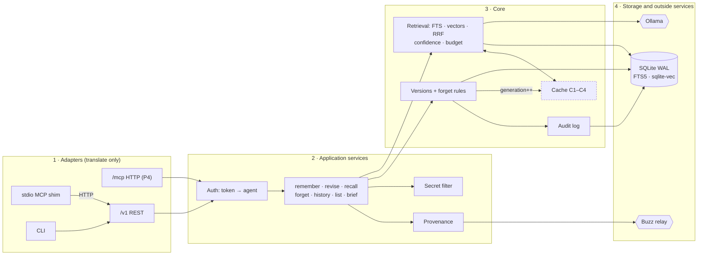
*Caption: internal layering (target). Calls only flow left to right. Rules live in layer 2–3, never in adapters ([ADR 0006](10-architecture/adr/0006-single-service-api-adapters.md)).*

---

## 4. A week in the life: one story, end to end

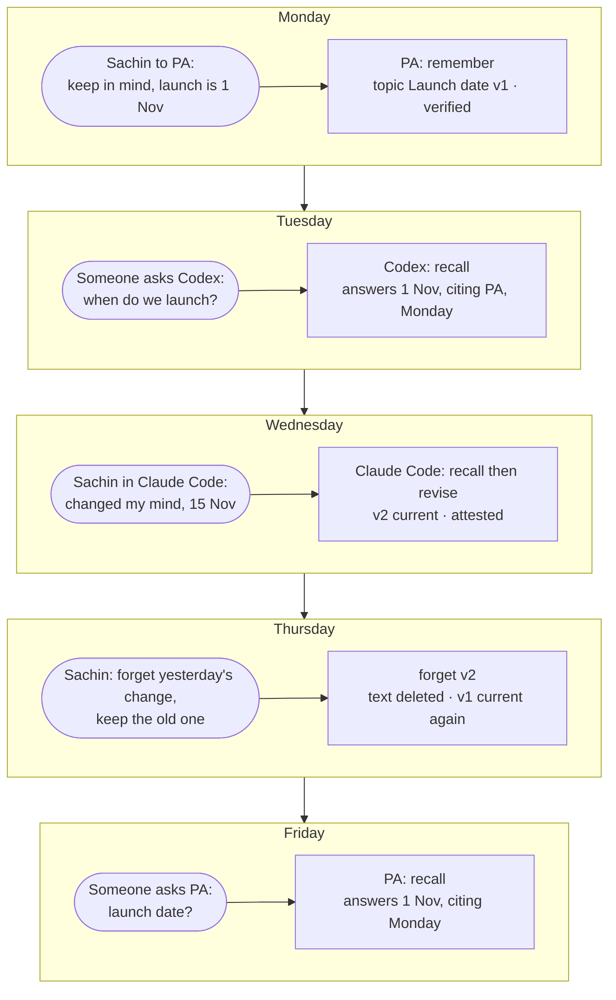
*Caption: user journey across agents (target; "verified" needs Phase 4).*

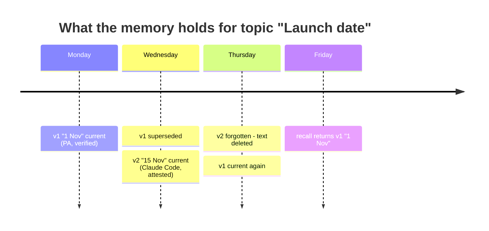
*Caption: the same story as stored state (target).*

---

## 5. The parts, one by one

| Part | What it does | Phase |
|---|---|---|
| **Daemon** | One always-on Python process on `127.0.0.1:7077`. Owns the database, search, caches and rules | P1 (manual or shim-started), P3 (launchd) |
| **REST `/v1`** | JSON endpoints, one per tool. The one true service API | P1 |
| **stdio shim** | Started by Claude Code or Codex as their MCP server. It speaks MCP to the tool and REST to the daemon. Holds no data | P1 |
| **MCP over HTTP `/mcp`** | For clients that connect by URL instead of launching a program | P4 |
| **CLI** | `agent-memory …` for Sachin and ops: register agents, search, history, doctor, backup | P1 → P3 |
| **Auth** | Bearer token → agent. Tokens are stored only as hashes, and revoked tokens get a 401 | P1 |
| **Provenance** | Every write must show Sachin asked: a quote (attested) or a signed Buzz message (verified) | P1 attested, P4 verified |
| **Secret filter** | Blocks passwords, API keys, OTPs, card numbers and Aadhaar numbers before anything is stored | P1 |
| **Versions + forget** | Topic/version rules: one current, revise, forget-and-revert | P1 |
| **Retrieval** | Keyword search (FTS5) in P1, adding meaning search (vectors) and RRF merge in P2, with confidence and size budget | P1 → P2 |
| **Embedder** | Calls local Ollama to turn text into vectors, with a backfill queue for when Ollama is down | P2 |
| **Cache** | C0–C5 speed layers, wiped on every write | P3 |
| **Audit log** | Who did what and when: IDs only, never text | P1 |
| **Backups** | Nightly copy, 14 kept | P3 |
| **Client presets** | `agent add --client codex` writes that tool's config for you | P4 |

---

## 6. Every flow, step by step

### 6.1 First-time setup
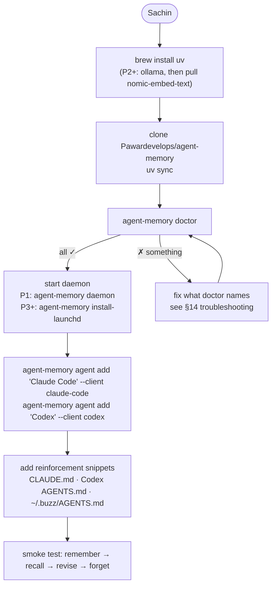
*Caption: install path (P1 manual parts and P3/P4 automated parts shown together).*

### 6.2 Registering an agent
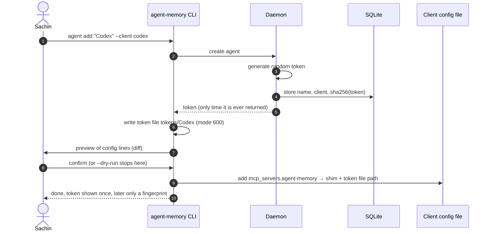
*Caption: agent registration (P1 manual config, P4 presets with preview).*

### 6.3 How a tool reaches the daemon
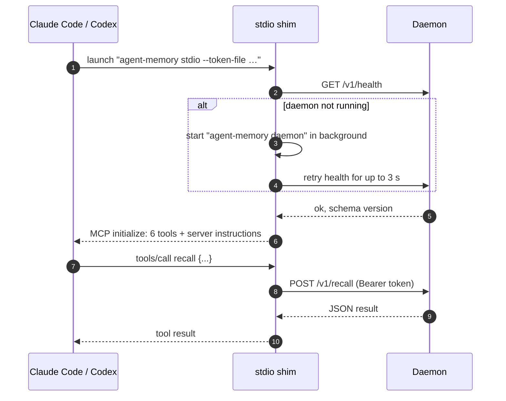
*Caption: connection path (Phase 1; launchd keeps the daemon up from P3).*

### 6.4 Remember (Phase 1: attested)
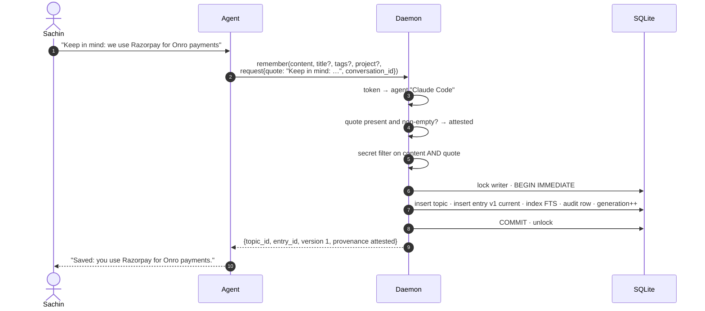
*Caption: Phase 1 write path. All checks run before the lock, so the transaction stays short.*

### 6.5 Remember (Phase 4: verified via Buzz)
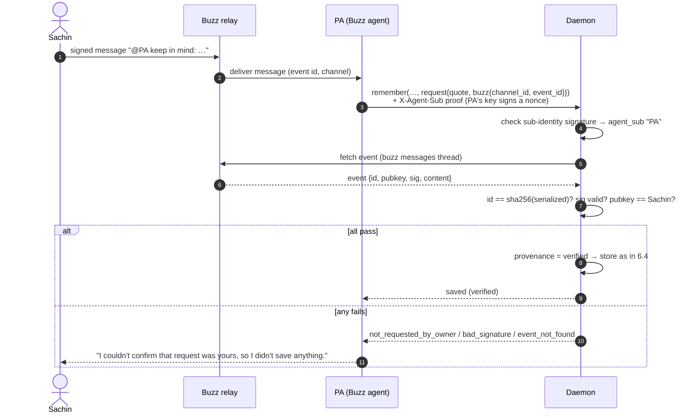
*Caption: verified provenance (Phase 4, [ADR 0003](10-architecture/adr/0003-provenance-verified-attested.md)).*

### 6.6 Remember when something similar exists (Phase 2)
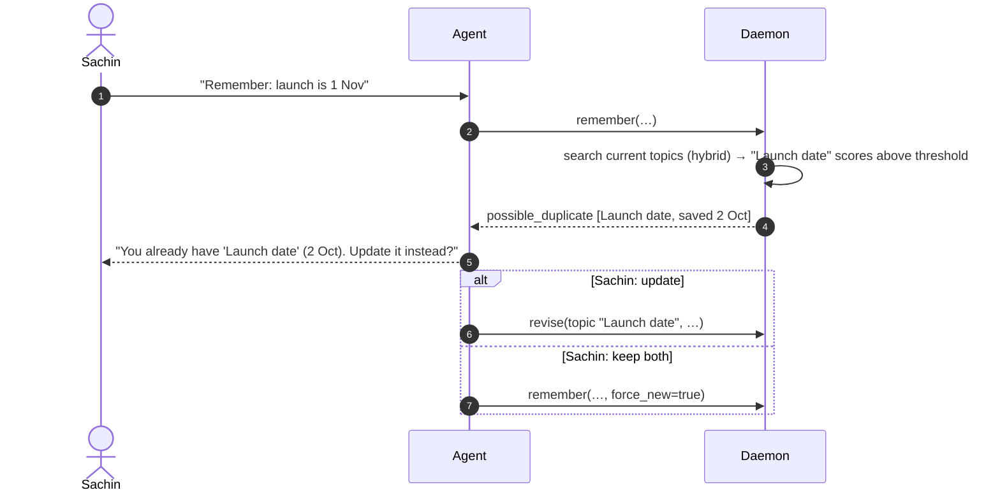
*Caption: duplicate check (Phase 2). Nothing is written until Sachin chooses.*

### 6.7 A secret is blocked
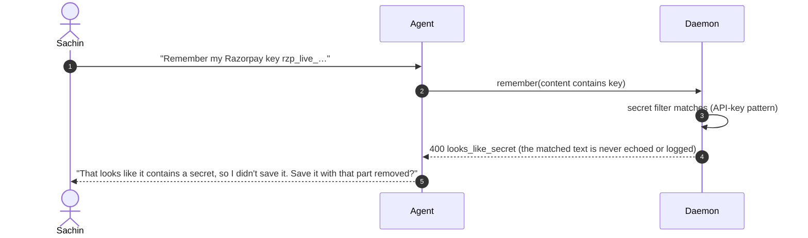
*Caption: secret filter (Phase 1). Use a password manager for secrets.*

### 6.8 Recall (Phase 1: keywords)
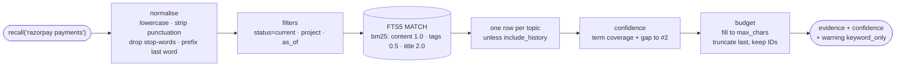
*Caption: Phase 1 recall pipeline ([RETRIEVAL](20-inference/RETRIEVAL.md)).*

### 6.9 Recall (Phase 2: keywords + meaning)
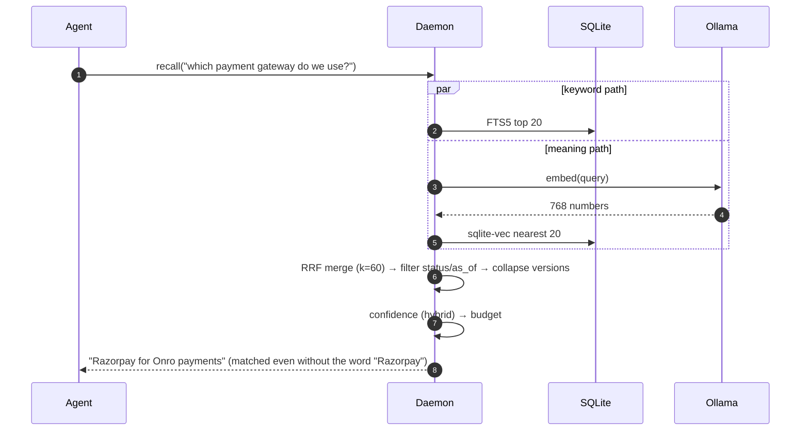
*Caption: hybrid recall (Phase 2). Section 8 explains RRF with numbers.*

### 6.10 Recall with cache (Phase 3)
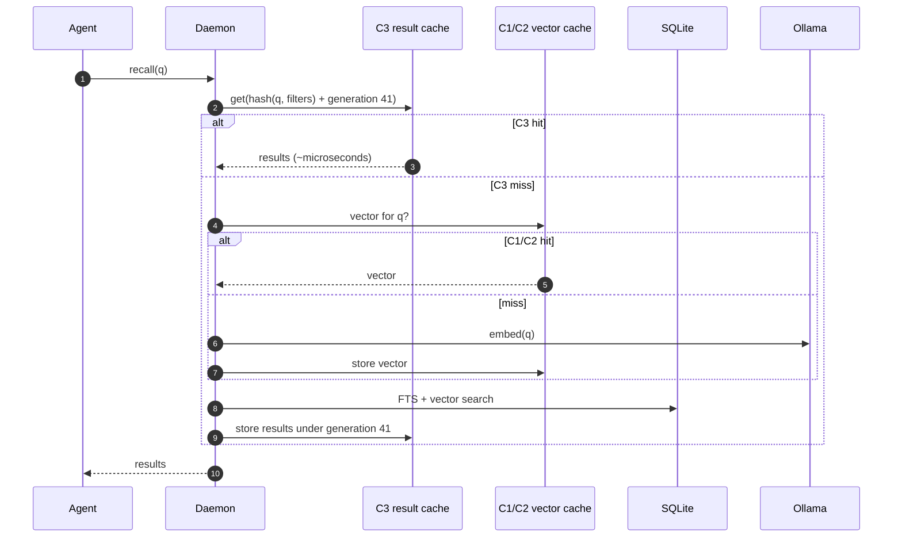
*Caption: cache read path (Phase 3, [ADR 0005](10-architecture/adr/0005-in-process-cache.md)).*

### 6.11 Revise (change of mind)
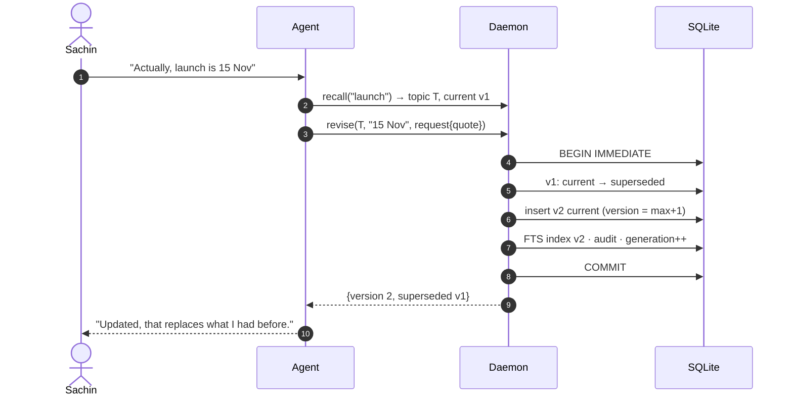
*Caption: revise (Phase 1). The database refuses two current versions even if the code had a bug.*

### 6.12 Forget: all four ways
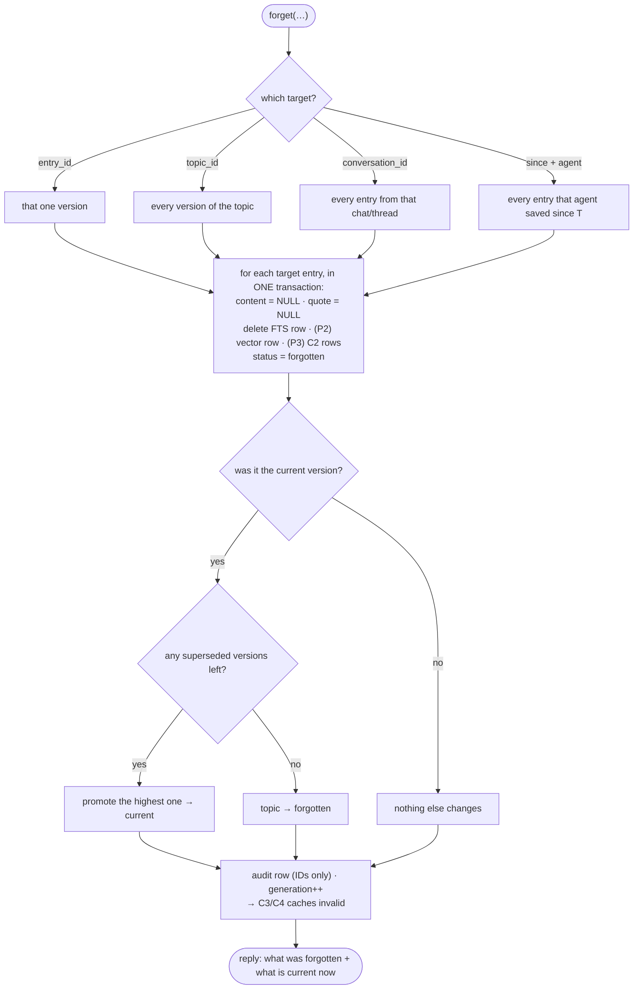
*Caption: forget logic (Phase 1, with P2/P3 layers noted; [ADR 0004](10-architecture/adr/0004-topics-versions-hard-forget.md)).*

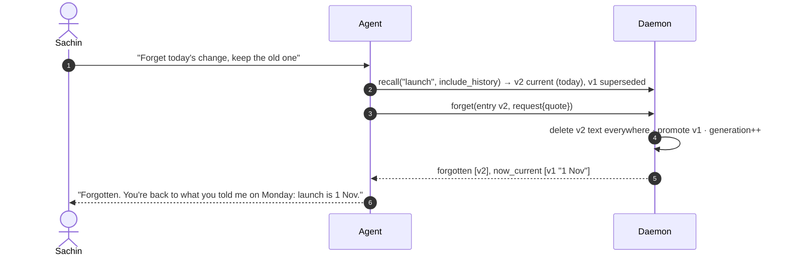
*Caption: the "keep the old one" case Sachin asked for (Phase 1).*

### 6.13 Time travel with `as_of`
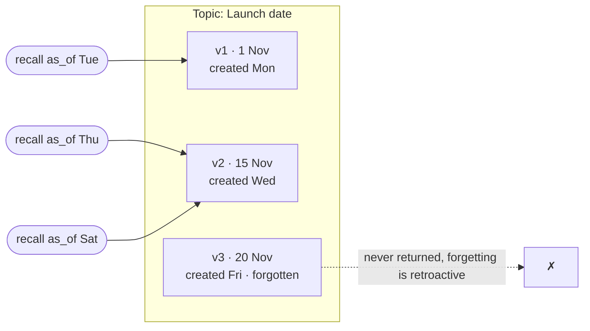
*Caption: `as_of` returns the latest non-forgotten version created at or before that time (Phase 1).*

### 6.14 Memory brief (Phase 3)
```mermaid
sequenceDiagram
  autonumber
  participant A as Agent (session start)
  participant D as Daemon
  participant C4 as C4 brief cache
  A->>D: brief(project="onro", max_chars=2000)
  D->>C4: brief for onro at generation 42?
  alt stale or missing
    D->>D: build from most-recalled + most recent current topics
    D->>C4: store with generation 42
  end
  D-->>A: summary + generated_at + topic IDs + "summary, not evidence"
  Note over A: For a direct question, the agent still calls recall. Fresh recall always wins
```
*Caption: explicit, scoped brief (Phase 3). It is never injected automatically.*

### 6.15 Auth failure and a revoked agent
```mermaid
sequenceDiagram
  autonumber
  actor S as Sachin
  participant CLI as CLI
  participant D as Daemon
  participant X as Old Cursor install
  S->>CLI: agent revoke "Cursor"
  CLI->>D: set revoked_at
  X->>D: POST /v1/recall (old token)
  D-->>X: 401 unauthorized (logged without the token)
  Note over X: The tool shows an MCP error. To restore access: agent rotate "Cursor"
```
*Caption: revocation (Phase 1).*

### 6.16 Ollama is down (Phase 2+)
```mermaid
flowchart TD
  R(["recall(q)"]) --> E{"Ollama reachable?"}
  E -->|yes| H["hybrid search"] --> OUT(["results"])
  E -->|no| K["keyword-only search"] --> W(["results + warning embedder_unavailable<br/>agent adds: '(keyword search only right now)'"])
  M(["remember(x)"]) --> E2{"Ollama reachable?"}
  E2 -->|yes| S1["save + embed now"]
  E2 -->|no| S2["save now · queue embed job"] --> BF["backfill when Ollama returns<br/>or agent-memory reembed"]
```
*Caption: degraded mode. Writes never fail because of Ollama.*

### 6.17 Nightly backup (Phase 3)
```mermaid
sequenceDiagram
  autonumber
  participant L as launchd (02:30)
  participant CLI as agent-memory backup
  participant DB as SQLite
  participant B as backups/
  L->>CLI: run
  CLI->>DB: sqlite online .backup (consistent while live)
  CLI->>B: memory-YYYYMMDD.db (mode 600)
  CLI->>B: delete copies older than 14
  Note over B: Tokens are never in backups. Forgotten text survives here until rotation (see §10)
```
*Caption: backups (Phase 3).*

---

## 7. How data is stored

Reference: [DATA_MODEL](10-architecture/DATA_MODEL.md).

```mermaid
erDiagram
  AGENTS ||--o{ TOPICS : creates
  AGENTS ||--o{ ENTRIES : writes
  TOPICS ||--|{ ENTRIES : "has versions"
  ENTRIES ||--o| ENTRIES_FTS : "keyword index (P1)"
  ENTRIES ||--o| ENTRIES_VEC : "vector (P2)"
  AGENTS ||--o{ AUDIT_LOG : acts
  AGENTS {
    text id PK
    text name UK
    text client
    text token_hash
    text revoked_at
  }
  TOPICS {
    text id PK
    text title
    text project
    text status "active|forgotten"
  }
  ENTRIES {
    text id PK
    text topic_id FK
    int version
    text content "NULL when forgotten"
    text status "current|superseded|forgotten"
    text agent_id FK
    text provenance "attested|verified"
    text request_quote "NULL when forgotten"
    text conversation_id
    text created_at
  }
  AUDIT_LOG {
    int id PK
    text ts
    text action
    text entry_id
    text agent_id
  }
```
*Caption: core schema (P1 tables plus P2 vector link).*

**Rules the database itself enforces** (code bugs can't break them):

| # | Rule | How |
|---|---|---|
| I1 | One current version per topic | Unique partial index `WHERE status='current'` |
| I2 | Version numbers unique per topic | `UNIQUE(topic_id, version)` |
| I3 | Forgotten = no text, no quote | `CHECK` constraint |
| I4 | Live entries have text and valid provenance | `CHECK` constraints |
| I5 | Status values are a closed set | `CHECK … IN (…)` |
| I6 | Audit never holds text | No text columns exist |
| I7 | Forgotten entries have no index rows | Tests + `doctor --deep` |

```mermaid
stateDiagram-v2
  [*] --> current: remember / revise
  current --> superseded: newer version saved
  superseded --> current: current one forgotten, highest left is promoted
  current --> forgotten: forget
  superseded --> forgotten: forget
  forgotten --> [*]
```
*Caption: entry lifecycle (Phase 1).*

```mermaid
stateDiagram-v2
  [*] --> active: first remember
  active --> active: revise / forget a version (others remain)
  active --> forgotten: forget topic, or last version forgotten
  forgotten --> [*]
```
*Caption: topic lifecycle (Phase 1).*

**Schema changes by phase:** `0001_init` (P1) → `0002_vectors` (P2) → `0003_cache` (P3) → `0004_buzz` (P4). Migrations only move forward, and an applied one is never edited.

---

## 8. How search works

Reference: [RETRIEVAL](20-inference/RETRIEVAL.md).

### 8.1 The pipeline
```mermaid
flowchart TD
  Q(["query"]) --> N["normalise"]
  N --> FI["filters: project · status · as_of"]
  FI --> K["keywords: FTS5 BM25 top 20"]
  FI --> V["meaning: vectors top 20 (P2)"]
  K & V --> M["RRF merge (P2) / BM25 order (P1)"]
  M --> C["collapse versions of a topic"]
  C --> CF["confidence: none · low · medium · high"]
  CF --> B["budget: max_chars, keep IDs + provenance"]
  B --> E(["evidence"])
```
*Caption: retrieval pipeline (P1 keyword only; P2 adds the vector branch).*

### 8.2 Why two kinds of search?
| | Keywords (FTS5) | Meaning (vectors) |
|---|---|---|
| Good at | Exact names, IDs, rare words: "Razorpay", "ONR-125" | Paraphrases: "payment provider" ≈ "Razorpay gateway" |
| Weak at | Different wording for the same idea | Exact codes, rare names |
| Cost | Under 1 ms | ~20–60 ms to embed the query (cached in P3) |

### 8.3 RRF with real numbers
Reciprocal Rank Fusion scores each result by **1 / (60 + rank)** in each list and adds the scores up. It needs no tuning, and a result that appears in both lists wins.

| Memory | Keyword rank | Meaning rank | RRF score | Final |
|---|---|---|---|---|
| A "Razorpay for Onro payments" | 1 | 3 | 1/61 + 1/63 = **0.0323** | 1st |
| C "Payment gateway contract signed" | — | 1 | 1/61 = **0.0164** | 2nd |
| B "Razorpay test keys rotated" | 2 | — | 1/62 = **0.0161** | 3rd |

### 8.4 Confidence decides what the agent says
```mermaid
flowchart LR
  R(["recall result"]) --> C{"confidence"}
  C -->|none| N["'I don't have anything saved about that.'"]
  C -->|low| L["'I'm not fully sure, but I may have noted … on <date>. Is that it?'"]
  C -->|medium / high| H["'You told me on <date> that …' (always cite agent + date)"]
```
*Caption: answer policy (all phases; [AGENT_UX §2.2](40-interfaces/AGENT_UX.md)).*

### 8.5 Measuring quality
`agent-memory eval` runs fixed fixtures (`tests/fixtures/memories.jsonl` and `queries.jsonl`) against a temporary database. It reports recall@k, MRR, false positives, and **leakage of superseded or forgotten text**. Any leakage blocks a release.

---

## 9. The cache layer

Reference: [OVERVIEW §6.1](10-architecture/OVERVIEW.md), [ADR 0005](10-architecture/adr/0005-in-process-cache.md). Arrives in Phase 3.

**Where the time actually goes:** reading SQLite takes under 1 ms. Embedding a query takes 20–60 ms, or 1–3 s if the model is cold. So the cache targets embeddings and repeated searches, not the database.

```mermaid
flowchart LR
  REQ(["recall"]) --> C3["C3 result cache<br/>500 · 10 min · keyed by generation"]:::cache
  C3 -->|miss| C1["C1 query-vector LRU<br/>2,000 in memory"]:::cache
  C1 -->|miss| C2[("C2 vector cache<br/>on disk · hashed keys")]:::cache
  C2 -->|miss| C0{{"C0 Ollama, model kept warm"}}
  C3 -->|miss| DB[("SQLite + C5 page cache / mmap")]
  BR(["brief"]) --> C4["C4 memory brief<br/>per project"]:::cache
  classDef cache stroke-dasharray: 4 3
```
*Caption: cache layers C0–C5 (Phase 3).*

**How a write makes caches safe instead of stale:**
```mermaid
sequenceDiagram
  autonumber
  participant A as Agent
  participant D as Daemon
  participant C3 as C3 result cache
  participant DB as SQLite
  A->>D: recall("launch date")
  D->>C3: key + gen 41 → hit: v1 "1 Nov"
  A->>D: forget(v1)
  D->>DB: delete text, FTS, vector and C2 rows, gen = 42 (in the commit path)
  A->>D: recall("launch date")
  D->>C3: key + gen 42 → miss (old entries unreachable)
  D->>DB: search → nothing current
  D-->>A: confidence none
```
*Caption: generation-based invalidation (Phase 3).*

**Three rules, each with a release-blocking test:**
1. **Forget is total.** Nothing forgotten comes back from any layer, and no layer stores query text in readable form.
2. **No stale reads.** Any recall that starts after a write is acknowledged sees that write.
3. **The cache is optional.** With the cache off, results are identical, only slower.

**Why not Redis:** it would be one more service to run and one more copy of private text for forget to chase, with no speed gain on one machine.

---

## 10. Security and trust

Reference: [THREAT_MODEL](30-security/THREAT_MODEL.md).

```mermaid
flowchart TB
  subgraph User["macOS user account - the real security boundary"]
    subgraph Clients["Local AI clients"]
      A1(["Claude Code"])
      A2(["Codex"])
      A3(["Buzz agents"])
    end
    TK[("tokens/ · mode 600")]
    subgraph D["Daemon: enforced controls"]
      AU["bearer auth · revocation"]
      PV["write gate: quote / Buzz signature"]
      SF["secret filter"]
      FG["forget across all layers"]
      LG["logs and audit without text"]
    end
    DB[("memory.db · mode 600")]
  end
  NET(["Network / other devices"]) -. "blocked: binds 127.0.0.1 only" .-> D
  A1 & A2 & A3 --> AU --> PV --> SF --> DB
  TK -. "any same-user process can read" .-> Clients
```
*Caption: trust boundaries (all phases).*

| What's protected | How | Honest limit |
|---|---|---|
| Who can call the memory | Localhost only + bearer tokens | Any program running as Sachin's macOS user could read token files |
| Which agent wrote what | Identity comes from the token, never from tool arguments | It's labelling, not isolation between local agents |
| "Only when Sachin asks" | Buzz messages are **verified** by signature (P4). Other tools must give Sachin's quote (**attested**) | Attested depends on the agent being honest. It's labelled, audited and reversible |
| No secrets stored | Pattern + checksum filter (Luhn, Verhoeff) on content and quote | Best effort: it can't catch every possible secret |
| Forget really forgets | Text, quote, FTS, vector and C2 deleted, caches invalidated, in one transaction | **Backups keep old copies for up to 14 days.** The wording is "forgotten from active memory" |
| No leaks in logs | The audit log has IDs only, and errors carry codes only | Tests grep logs for planted markers |

**Severity view** (from the threat model): the one CRITICAL threat is forgotten text staying reachable. The HIGH threats are unauthorised API access, identity spoofing, writes without Sachin's intent, accidental secret storage, and leaks through logs. The MEDIUM threats are backup retention surprise and unsafe client config writes.

---

## 11. How agents must behave

The daemon sends these **server instructions** to every client when it connects ([OVERVIEW §6.4](10-architecture/OVERVIEW.md#64-mcp-server-instructions-canonical-text)):

```mermaid
flowchart TD
  M(["Sachin's message"]) --> W{"Does it explicitly ask to remember,<br/>keep in mind or note something?"}
  W -->|yes| R1["recall first: does a topic already exist?"]
  R1 -->|no| REM["remember(content, request.quote = exact words)"]
  R1 -->|yes, he changed his mind| REV["revise(topic)"]
  W -->|"no, but it asks about past facts,<br/>decisions or preferences"| RC["recall"]
  RC --> CF{"confidence"}
  CF -->|none| N1["'Nothing saved on that.' Never guess"]
  CF -->|low| N2["hedge and ask to confirm"]
  CF -->|medium/high| N3["answer + cite agent and date"]
  W -->|"asks to forget"| FG["recall/history to find the target → forget → say what is current now"]
  W -->|"none of these"| NO["do not touch memory"]
```
*Caption: agent decision flow (all phases).*

**What Sachin hears** ([AGENT_UX](40-interfaces/AGENT_UX.md)):
- Saved: *"Saved: …"*
- Revised: *"Updated, that replaces what I had before."*
- Forgotten: *"Forgotten. You're back to what you told me on <date>: …"* or *"Nothing's saved on that anymore."*
- Error codes, JSON, signatures and the word "attested" are never spoken in conversation.

---

## 12. Interfaces: MCP, REST, CLI

| Tool (MCP) = endpoint (REST `POST /v1/<tool>`) | Main inputs | Returns | Phase |
|---|---|---|---|
| `remember` | content, title?, kind?, tags?, project?, request{quote, conversation_id?, buzz?}, force_new? | topic_id, entry_id, version 1, provenance, or `possible_duplicate` (P2) | P1 |
| `revise` | topic_id, content, request | new version, superseded id | P1 |
| `recall` | query, project?, as_of?, include_history?, limit=8, max_chars | results[], confidence, warnings | P1 (hybrid P2) |
| `forget` | entry_id \| topic_id \| conversation_id \| {since, agent?}, request | forgotten[], now_current[] | P1 |
| `history` | topic_id | all versions, with forgotten ones as markers | P1 |
| `list` | project?, since?, agent?, limit | current topics | P1 |
| `brief` | project?, max_chars=2000 | summary + topic IDs + generation | P3 |
| `GET /v1/health` | none | ok, schema version (no auth, no data) | P1 |

**Errors:**

| HTTP | Code |
|---|---|
| 400 | `missing_quote`, `invalid_args`, `looks_like_secret` |
| 401 | `unauthorized` |
| 403 | `not_requested_by_owner`, `bad_signature` (P4) |
| 404 | `not_found`, `event_not_found` (P4) |
| 409 | `conflict` |
| 500 | `internal` |

Warnings: `keyword_only`, `low_confidence`, `embedder_unavailable`, `truncated`, `as_of_no_current_match`, `cache_disabled`.

**CLI** (each read command takes `--json`; destructive commands confirm unless `--yes` is given):

| Command | Purpose | Phase |
|---|---|---|
| `daemon` / `install-launchd` | run in the foreground / install as a service | P1 / P3 |
| `stdio --token-file` | the MCP shim | P1 |
| `agent add\|list\|revoke\|rotate` | manage agents (`--dry-run` previews config) | P1, presets P4 |
| `recall`, `list`, `history`, `brief` | inspect memory | P1, brief P3 |
| `doctor [--deep]` | health checks | P1 |
| `eval` | retrieval quality | P1 fixtures, P2 gates |
| `backup`, `export`, `reembed`, `stats` | operations | P3 |

---

## 13. Where it runs: files, processes, lifecycle

```mermaid
flowchart TB
  subgraph Home["~/.buzz/agent-memory/ (mode 700)"]
    DB[("memory.db + WAL files (600)")]
    CFG["config.toml<br/>owner pubkey · port · model"]
    TOK[("tokens/NAME (600)")]
    LOG["logs/daemon.log<br/>no text, no tokens"]
    BK[("backups/ (P3)")]
  end
  REPO["~/.buzz/REPOS/agent-memory<br/>uv project"] -->|"uv run agent-memory daemon"| D["daemon :7077"]
  LA["launchd plist, KeepAlive (P3)"] --> D
  D --> DB & LOG
  SH["shim per client session"] --> TOK
  SH --> D
  D --> OL{{"Ollama :11434 (P2)"}}
```
*Caption: deployment (Phase 1 base, with P2/P3 parts labelled).*

```mermaid
stateDiagram-v2
  [*] --> Stopped
  Stopped --> Starting: launchd / shim / manual
  Starting --> Migrating: open DB, check schema version
  Migrating --> Refusing: DB schema newer than code
  Migrating --> WarmingUp: migrations applied
  WarmingUp --> Ready: (P2+) model warm-up done or skipped
  Ready --> Degraded: Ollama unreachable
  Degraded --> Ready: Ollama back, backfill runs
  Ready --> Stopped: shutdown / crash
  Stopped --> Starting: launchd KeepAlive restarts (P3)
  Refusing --> [*]
```
*Caption: daemon lifecycle (P1 base, P2/P3 states noted).*

**Concurrency:** one writer connection behind a lock and a small pool of readers. WAL mode lets readers keep reading while a write happens, so up to 20 parallel clients are tested.

---

## 14. Operating it: health, metrics, troubleshooting

| Signal | Where | Phase |
|---|---|---|
| Health | `GET /v1/health`, `agent-memory doctor` | P1 |
| Logs | request id, endpoint, agent, latency, result count, confidence, error code. **Never** text, quotes, queries or tokens | P1 |
| Metrics | cache hits/misses per layer, recall p50/p95, embed latency | P3 `stats` |
| Quality | `agent-memory eval` | P1/P2 |

```mermaid
flowchart TD
  P(["Agent says the memory tool failed"]) --> H{"agent-memory doctor"}
  H -->|daemon unreachable| D1["start: agent-memory daemon<br/>or check launchd (P3)"]
  H -->|401 for this agent| D2["agent list → revoked?<br/>agent rotate NAME"]
  H -->|schema newer than code| D3["update the repo: git pull + uv sync"]
  H -->|sqlite-vec failed| D4["P2: use the uv-managed Python<br/>(see SPIKE_RESULTS)"]
  H -->|Ollama ✗| D5["ollama serve; ollama pull nomic-embed-text<br/>recall still works keyword-only"]
  H -->|file modes ✗| D6["chmod 700 dir, 600 db and tokens"]
  H -->|all ✓| D7["check the client's MCP config points to the shim + token file"]
```
*Caption: troubleshooting tree (P1–P3).*

---

## 15. Build phases and roadmap

Reference: [ROADMAP](ROADMAP.md), [ADR 0007](10-architecture/adr/0007-phased-delivery-fts-first.md).

```mermaid
flowchart LR
  P0["Phase 0 · Spike<br/>prove sqlite-vec, Ollama,<br/>MCP transports, launchd"] --> P1["Phase 1 · Core memory<br/>daemon · REST · shim · tokens<br/>FTS recall · versions · forget"]
  P1 --> P2["Phase 2 · Inference quality<br/>embeddings · hybrid RRF<br/>duplicates · confidence · evals"]
  P2 --> P3["Phase 3 · Cache and ops<br/>C0–C4 · stats · backups<br/>export · reembed · launchd"]
  P3 --> P4["Phase 4 · Integrations<br/>Claude Code · Codex · Buzz<br/>verified provenance · /mcp"]
  P4 --> L["Later<br/>Cursor · Desktop · VS Code"]
```
*Caption: phase sequence. A phase starts only when the previous phase's rules pass.*

```mermaid
gantt
  title Estimated build effort, if Phase 0 starts on 2026-10-14 (working days)
  dateFormat YYYY-MM-DD
  axisFormat %d %b
  excludes weekends
  section Phase 0
  Spike                       :p0, 2026-10-14, 1d
  section Phase 1
  Schema, store, versions     :p1a, after p0, 1d
  REST, auth, shim, CLI       :p1b, after p1a, 1d
  Forget, audit, tests        :p1c, after p1b, 1d
  section Phase 2
  Embeddings, hybrid, evals   :p2, after p1c, 2d
  section Phase 3
  Cache, backups, ops         :p3, after p2, 1d
  section Phase 4
  Presets, Buzz verify, smoke :p4, after p3, 1d
```
*Caption: rough estimate, about 8 developer-days including the spike and excluding review wait time. The dates are illustrative only, and it will be re-estimated after Phase 0.*

**What "done" means for Phase 1** ([OUTPUT](10-architecture/phase-1/OUTPUT.md)): any registered local agent can save (attested), find by keyword, revise, forget-and-revert, and view history. Tests prove that forgotten text is absent from rows and the FTS index, that attribution comes from the token, and that the stdio shim and REST give identical results.

---

## 16. How the team delivers it

Reference: [WORKFLOW](60-process/WORKFLOW.md).

```mermaid
sequenceDiagram
  participant Dev as Developer
  participant PR as GitHub PR (Pawardevelops)
  participant CR as Code Reviewer
  participant TE as Test Engineer
  participant SR as Security Reviewer
  participant RE as Release Engineer
  Dev->>PR: small PR for one phase slice + test evidence
  PR->>CR: correctness
  PR->>TE: tests and evals
  PR->>SR: when auth, deletion, secrets or logs are touched
  PR->>RE: when install, launchd or backups are touched
  CR-->>PR: approve / changes
  TE-->>PR: approve / changes
  SR-->>PR: approve / changes
  RE-->>PR: approve / changes
```
*Caption: PR flow (all phases).*

**Rules:**
- All GitHub work happens under **github-work / Pawardevelops** only.
- Commits are authored as `Pawardevelops <pawardevelops@gmail.com>`, using the env-var override in [AGENTS.md](../AGENTS.md), because the Buzz runtime injects its own identity.
- Each agent works in its own git worktree.
- Code goes through PRs, never straight to `main`.
- Linear is not used. Phases are tracked in ROADMAP, and GitHub Projects will be used once the github-work account is connected to the tools.

**Who owns what:**

| Area | Owner |
|---|---|
| Architecture and ADRs | Architect |
| Inference, stack and roadmap | Tech Lead |
| Security | Security Reviewer |
| Agent UX | Designer |
| Goal and process | Engineering Guide |
| Build | Developer / Coder |

---

## 17. Technology choices

Reference: [STACK_AND_SKILLS](50-tech/STACK_AND_SKILLS.md).

| Technology | Role | Why this one |
|---|---|---|
| Python 3.13 + uv | Language and packaging | Fastest to build, with the best SQLite and MCP libraries |
| SQLite (WAL) | The single store | One file, no server, simple backups, sub-millisecond reads |
| FTS5 | Keyword search | Built into SQLite |
| sqlite-vec | Vector search | Lives in the same file, so forget deletes from one place |
| Ollama + nomic-embed-text | Local embeddings | Text never leaves the Mac. One warm model is shared by everyone |
| Official MCP SDK | Agent interface | Every target client speaks MCP |
| Starlette + Uvicorn | Daemon HTTP | Light, async, and serves both REST and MCP HTTP |
| httpx | Shim → daemon | Simple local HTTP client |
| coincurve | Buzz signature checks | Schnorr / secp256k1 for Nostr events |
| launchd | Keep the daemon alive | Built into macOS |
| pytest | Tests and evals | Standard |

**Deliberately not used:**

| Technology | Why not |
|---|---|
| Redis | Extra service and an extra place for forgotten data to hide |
| Postgres / pgvector | Too heavy for one person |
| Cloud embeddings | Text would leave the Mac |
| Hosted memory services (mem0 and the like) | Can't give owner-only writes plus forget-reverts together |
| A UI | Out of scope |

---

## 18. Decisions on record

| ADR | Decision | One-line reason |
|---|---|---|
| [0001](10-architecture/adr/0001-local-daemon-sqlite.md) | One local daemon, SQLite as source of truth | Zero ops, one file, fast |
| [0002](10-architecture/adr/0002-any-agent-token-identity.md) | Any agent, token registry | Works beyond Buzz, and identity never comes from the model |
| [0003](10-architecture/adr/0003-provenance-verified-attested.md) | Verified vs attested provenance | Cryptographic proof where possible, honest labels elsewhere |
| [0004](10-architecture/adr/0004-topics-versions-hard-forget.md) | Topics with versions, hard forget that reverts | "Changed my mind" and "keep the old one" both work |
| [0005](10-architecture/adr/0005-in-process-cache.md) | In-process cache, no Redis | Speed where it matters, with no stale or forgotten leaks |
| [0006](10-architecture/adr/0006-single-service-api-adapters.md) | One service API, MCP/REST as adapters | Same behaviour everywhere |
| [0007](10-architecture/adr/0007-phased-delivery-fts-first.md) | Phased, FTS first | Prove correctness before intelligence |
| [0008](10-architecture/adr/0008-docs-per-phase-snapshots.md) | Docs: living target + per-phase snapshots | Architecture will evolve, and history stays readable |

---

## 19. Limits, open questions, and the future

**Known limits (accepted):**
- Agent identity is a label between same-user programs, not a hard wall.
- Attested writes trust the agent to quote Sachin honestly.
- Forgotten text lingers in backups for up to 14 days.
- Phase 1 misses paraphrases until Phase 2.

**Open decisions** (each needs an ADR before it is built):
1. Purge forgotten entries from backups early?
2. Redacted vs full export?
3. Tokens in macOS Keychain?
4. Ever allow cloud agents (ChatGPT web, claude.ai)? That would need a tunnel plus OAuth, as a separate design.

**Not in scope:** a UI, multiple users, syncing across devices, automatic capture, an external cache, password storage.

```mermaid
flowchart LR
  NOW["Today<br/>docs complete"] --> P0["Phase 0 spike"] --> P1["Phase 1 core"] --> P2["Phase 2 quality"] --> P3["Phase 3 cache/ops"] --> P4["Phase 4 integrations"]
  P4 -.-> F1["More clients<br/>Cursor · Desktop · VS Code"]
  P4 -.-> F2["Keychain tokens?"]
  P4 -.-> F3["Remote access?<br/>separate design"]
  P4 -.-> F4["Browse/edit UI?<br/>only if wanted"]
```
*Caption: where things stand and possible futures.*

---

## 20. FAQ

**Will agents save everything I say?**
No. They save only when you explicitly ask ("remember", "keep in mind", "note this"). Each save carries your exact words as proof.

**How do I know an answer came from memory and not a guess?**
The agent cites who saved it and when. If nothing matches, it must say nothing is saved.

**I changed my mind. Do I need to delete the old one?**
No. Say the new decision. The agent revises the topic: the new version becomes current and the old one is kept as history.

**"Forget the current one, keep the old." Does that work?**
Yes. The newest version is deleted for real, and the previous version becomes current automatically.

**Can one agent pretend to be another?**
Not through the API: identity comes from the agent's token. A program running as your macOS user could still read token files, which is a documented limit.

**Does my text go to the cloud?**
No. Search, embeddings and storage all run on your Mac. The only outbound call is to the Buzz relay, to check that a Buzz request was signed by you (Phase 4).

**What if Ollama isn't running?**
Search falls back to keywords with a short note. Saving still works, and meaning search catches up later.

**Where's the data and how do I back it up?**
In `~/.buzz/agent-memory/memory.db`. From Phase 3, nightly backups keep 14 copies.

**Can I see everything stored?**
Yes. Use `agent-memory list`, `history`, and (P3) `export --json`.

**What happens to a forgotten fact inside the cache?**
It's gone. Forget deletes its cached vectors, and the generation bump makes every cached result and brief unreachable.
