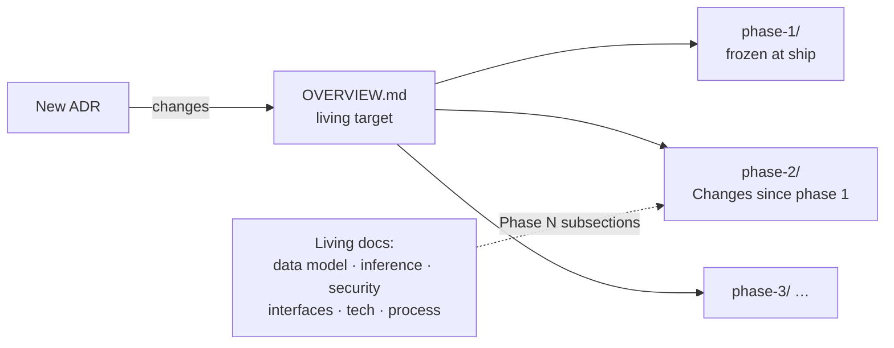

# agent-memory documentation

agent-memory is shared, local, long-term memory for any AI agent on Sachin's Mac. Agents save a fact **only when Sachin explicitly asks** ("keep in mind…"). They can recall it later with a citation, revise it when he changes his mind, and forget it so that the previous version comes back.

## Map

| Area | Document | Owner | What it answers |
|---|---|---|---|
| Vision | [00-vision/END_GOAL.md](00-vision/END_GOAL.md) | Engineering Guide | Why this exists, who it serves, what success looks like |
| Architecture | [10-architecture/OVERVIEW.md](10-architecture/OVERVIEW.md) | Architect | The **target** system across all phases |
| | [10-architecture/phase-1/ARCHITECTURE.md](10-architecture/phase-1/ARCHITECTURE.md) | Architect | What Phase 1 actually builds, with diagrams |
| | [10-architecture/phase-1/OUTPUT.md](10-architecture/phase-1/OUTPUT.md) | Tech Lead | Phase 1 deliverables and acceptance |
| | [10-architecture/DATA_MODEL.md](10-architecture/DATA_MODEL.md) | Architect | Schema, ER diagram, state machine, migrations by phase |
| | [10-architecture/adr/](10-architecture/adr/README.md) | Architect (anyone may add) | Every significant decision, one per file |
| Inference | [20-inference/RETRIEVAL.md](20-inference/RETRIEVAL.md) | Tech Lead | Ranking, confidence, context budget, evals |
| Security | [30-security/THREAT_MODEL.md](30-security/THREAT_MODEL.md) | Security Reviewer | Trust model, threats, controls |
| Interfaces | [40-interfaces/AGENT_UX.md](40-interfaces/AGENT_UX.md) | Designer | Tool contracts as agents see them, errors, CLI, diagram style |
| Technology | [50-tech/STACK_AND_SKILLS.md](50-tech/STACK_AND_SKILLS.md) | Tech Lead | Each technology, why we chose it, and the skills needed |
| Process | [60-process/WORKFLOW.md](60-process/WORKFLOW.md) | Engineering Guide | Phases, PR flow, review gates |
| Plan | [ROADMAP.md](ROADMAP.md) | Tech Lead | Phase scope and exit criteria |
| Legacy | [DESIGN.md](DESIGN.md) | Architect | A pointer only. The v1–v3 single-file spec has been split into the files above, and the full text is in git history at `434aa4b` |

## How these docs change over time

The architecture will change in Phase 2 (embeddings), Phase 3 (cache and ops) and Phase 4 (integrations), and again for optimisation and security work. The structure is built for that:

1. **Snapshots per phase.** `10-architecture/phase-N/` describes the system *as built* in phase N.
   - When a phase ships, set its files to `status: frozen`. After that, only fix factual errors.
   - The next phase gets a new folder with a **"Changes since phase N-1"** section at the top.
2. **One living target.** `10-architecture/OVERVIEW.md` always shows the end-state design. It changes only through an ADR.
3. **Decisions are append-only.** Each change of direction is a new ADR in `adr/`.
   - Never delete or rewrite an old ADR. Set its status to `Superseded by NNNN` and link forward.
4. **Living docs vs snapshots.** These docs are living and are updated in place, with the change in the PR description:
   - inference
   - security
   - interfaces
   - tech
   - process
   - data model
   - Every change must also update `last_reviewed`.
   - When a phase changes a contract, the doc gets a **"Phase N" subsection** instead of losing the old behaviour.
5. **Frontmatter on every doc:** `title`, `owner`, `status` (draft | active | frozen | superseded), `applies_to` (phase-1 … | all-phases), `last_reviewed`.
6. **Diagrams are Mermaid in the markdown.** They can be diffed, they're reviewed in the same PR as the text, and they render on GitHub. Don't commit binary diagram images.
7. **Code and docs move together.** A PR that changes behaviour updates the matching doc, or explains in its description why no doc applies.

