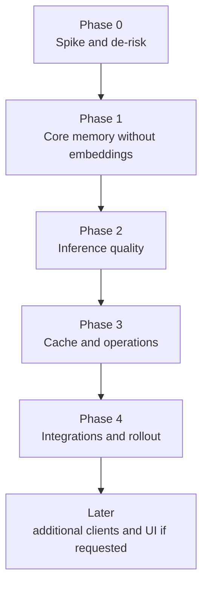

# agent-memory roadmap

This project uses the GitHub repo and PRs as the source of truth. Linear is intentionally not required for this build.

## Phase map

## Phase 0: spike and de-risk
Goal: prove the local stack before building product behaviour.

Scope:
- Confirm the chosen Python can load `sqlite-vec`.
- Confirm Ollama `nomic-embed-text` runs locally and record vector dimension and warm/cold latency.
- Confirm MCP stdio and HTTP support for Claude Code and Codex.
- Confirm launchd can start, stop and keep the daemon alive.
- Confirm client config paths and add dry-run behaviour for config writes.

Exit criteria:
- A short `docs/SPIKE_RESULTS.md` with commands run, results, risks and chosen fallback.
- No production daemon behaviour required yet.

Review gate:
- Tech Lead confirms the chosen fallback for any failed spike.

## Phase 1: core memory without embeddings
Goal: make the correctness model solid using SQLite and FTS only.

Scope:
- Daemon skeleton on `127.0.0.1`.
- REST endpoints for `remember`, `revise`, `recall`, `forget`, `history`, `list`.
- Token registry and attribution.
- SQLite schema, migrations, WAL settings and one-current-per-topic invariant.
- FTS5 recall with rank metadata and confidence.
- Versioned revise and forget/revert semantics.
- Audit log without memory content.
- Stdio shim forwarding to the daemon.
- CLI basics: daemon, stdio, agent add/list/revoke, recall, list, history, doctor.

Exit criteria:
- Unit tests cover provenance, attribution, versioning, recall, forget, secret filtering, token revocation and cross-transport parity.
- Forgotten content is absent from active rows and FTS.

Review gate:
- Code Reviewer checks server boundaries and invariants.
- Test Engineer checks lifecycle and deletion test coverage.
- Security Reviewer checks token handling, logs and local file permissions.

## Phase 2: inference quality
Goal: improve recall quality and make regressions measurable.

Scope:
- Ollama embedder client and backfill queue.
- `sqlite-vec` storage and vector recall.
- Hybrid ranking with reciprocal rank fusion.
- Duplicate detection on remember.
- Confidence classification and recall warnings.
- `max_chars` context budgeting and truncation markers.
- Deterministic eval fixtures and `agent-memory eval`.

Exit criteria:
- Hybrid recall improves paraphrase evals without increasing false positives.
- Forgotten and superseded content never appears in active recall or eval output.

Review gate:
- Tech Lead checks retrieval metrics and confidence behaviour.
- Test Engineer checks eval fixtures and regression gates.

## Phase 3: cache and operations
Goal: make the daemon fast and usable day to day.

Scope:
- C0-C3 caches and generation-based invalidation.
- C4 scoped memory brief, explicit only.
- Metrics and `agent-memory stats`.
- Backups with 14-day rotation.
- Export and reembed commands.
- Keyword-only degradation when Ollama is unavailable.

Exit criteria:
- Cache-on and cache-off results are identical.
- Writes invalidate result and brief caches.
- Forget deletes active content from caches.

Review gate:
- Security Reviewer checks that caches do not weaken forget semantics.
- Release Engineer checks backup and restore behaviour before local install.

## Phase 4: integrations and rollout
Goal: connect the first clients and install safely on Sachin's Mac.

Scope:
- Codex registration.
- Claude Code registration.
- Buzz agent sub-identity proof and verified provenance.
- Reinforcement snippets for Codex, Claude Code and Buzz agents.
- Live smoke test across PA, Codex and Claude Code.

Exit criteria:
- PA can save a verified memory.
- Codex can recall it.
- Claude Code can revise it as attested.
- A forget of the current version restores the previous version.

Review gate:
- Release Engineer owns installation and rollback notes.
- Security Reviewer validates verified provenance and token storage.

## Later
- Cursor, Claude Desktop and VS Code presets.
- UI for browse/edit if requested.
- Remote/cloud-agent access only with a separate secure-tunnel and OAuth design.

## PR rules
- Work from `docs/project-docs` for documentation coordination.
- Implementation work should use feature branches from the approved documentation state.
- Commit identity must be `Pawardevelops <pawardevelops@gmail.com>`.
- Use the `github-work` remote only.
- PRs should name the phase, list acceptance criteria, include test evidence and note security/release impact.
